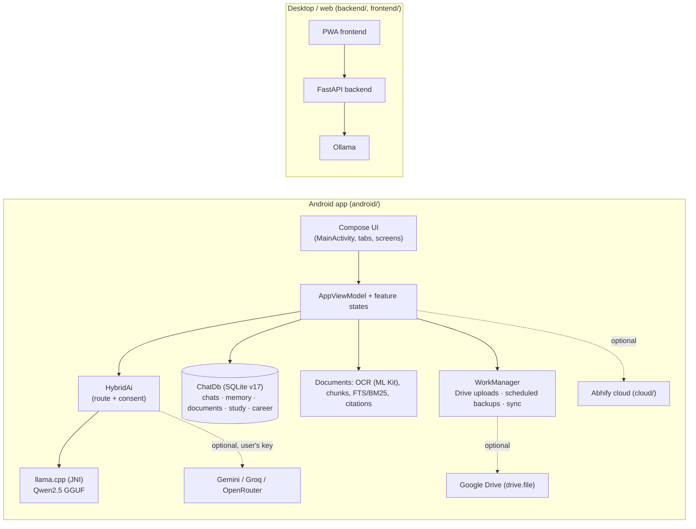

<p align="center"></p>

<h1 align="center">Abhify.AI</h1>
<p align="center"><b>Learn AI. Think Deeper. Build the Future.</b></p>

Abhify.AI is a **local-first AI assistant for learning, knowledge and work**. It is for students, developers and professionals who want an AI companion that runs on their own device, keeps their chats, documents and memories private by default, and uses the cloud only when they choose to.

This repository holds **three products** that share the brand and ideas:

| Product | What it is | Version | AI runs on | Docs |
|---|---|---|---|---|
| **Abhify.AI for Android** (`android/`) | Native Kotlin/Compose app: chat, documents, study, career, news, projects, knowledge, personal memory, Google Drive | **5.4** (debug build `build/Abhify-5.4.apk`; internal builds in `build/internal/`, newest `Abhify-6.0-dev.1.apk`; not published) | **The phone** (llama.cpp + Qwen2.5 GGUF). Optional online providers with your own key. | [PROJECT_ARCHITECTURE.md](docs/PROJECT_ARCHITECTURE.md) |
| **Abhify.AI desktop and web** (`backend/`, `frontend/`, `desktop/`, `packaging/`) | FastAPI backend + PWA, Windows installer, phone companion | `2.0.0-dev.8` (source) | **Ollama** on your PC | [Desktop and web app](#desktop-and-web-app) below |
| **Abhify cloud** (`cloud/`) | Optional accounts, sync and AI gateway | `1.0.0-dev.1` (not deployed) | Ollama on a server | [ANDROID_DEPLOYMENT.md](docs/ANDROID_DEPLOYMENT.md) |

> **Status:** active development, nothing published.
> - **Android 5.4 / internal 6.0-dev.1:** 426 automated JVM tests (0 failing) and lint with 0 errors. The owner reported 5.0 working on the phone. The Local RAG and 5.1 features are **not yet checked on a phone**.
> - **Desktop:** the backend has 390 tests (0 failing). Browser end-to-end tests run live on Ollama. The desktop installer is unsigned.
>
> See [docs/ABHIFY_MASTER_ENHANCEMENT_TRACKER.md](docs/ABHIFY_MASTER_ENHANCEMENT_TRACKER.md).

## What's new in 5.0 (Android) and 2.0.0-dev.8 (desktop/web)
| Area | What you get | Docs |
|---|---|---|
| **Career** | Dashboard · Resumes · Question Bank · MCQs · Jobs · Match. **Resume-based interview questions** (technical, project, scenario, behavioural…). **MCQ practice** from your resume, skills, projects, a topic or a document, in batches for as long as you like, with no repeats, an immediate Correct/Incorrect with the right answer and explanation, and every answer labelled *AI-generated, not independently verified*. Progress per session, resume/topic and overall. | [MCQs](docs/ABHIFY_CAREER_MCQ_GENERATION.md), [Question Bank](docs/ABHIFY_CAREER_QUESTION_BANK.md), [Resumes](docs/ABHIFY_CAREER_RESUME_INTELLIGENCE.md) |
| **News** | Tap a story to **read it inside the app**: a 2–3 paragraph summary of that story's own text (honest when only a short description exists). **Read more** shows the full text in the app; the second tap opens the original. **Listen** reads it aloud. Reliable **refresh** and **pull-to-refresh**. | [Reading](docs/ABHIFY_NEWS_IN_APP_READING.md), [Audio](docs/ABHIFY_NEWS_AUDIO.md), [Refresh](docs/ABHIFY_REFRESH_BEHAVIOR.md) |
| **Projects** | Projects with instructions, linked documents, a project chat that uses only its documents, AI tasks and study plans on them; archive, export; delete keeps documents. | [Project Workspace](docs/ABHIFY_PROJECT_WORKSPACE.md) |
| **AI Task Runner** | Document summary, study plan and quiz fixed and improved (tolerant quiz reading, quiz settings and score, export), news briefing, custom tasks. | [Task Runner fixes](docs/ABHIFY_TASK_RUNNER_FIXES.md), [Task Runner](docs/AI_TASK_RUNNER.md) |
| **Chat** | Streamed answers with Stop on the desktop; the model loads while you speak (voice); New private chat crash fixed on Android. | [Chat performance](docs/ABHIFY_CHAT_PERFORMANCE.md) |
| **Navigation** | One brand launcher; AI and System settings in **Settings**; More keeps Workspace, Data and Account/About. | [Navigation & Settings](docs/ABHIFY_NAVIGATION_SETTINGS.md), [Unified workspace](docs/UNIFIED_AURORA_WORKSPACE.md) |

## Version history (all enhancements, newest first)
Full details: [docs/CHANGELOG.md](docs/CHANGELOG.md) (Android) and [CHANGELOG.md](CHANGELOG.md) (desktop/web).

### Android
| Version | Highlights |
|---|---|
| **5.4** (2026-11-18) | Personal Voice Companion: hands-free conversation with tap-to-interrupt, voice commands for Abhify (typed action registry with confirmations), Voice & Conversation settings (real voices, tone, speed, language, response mode), Conversation data controls |
| **5.3** (2026-11-18) | Five destinations (Home · Assistant · Study · News · More), grouped More, neural core with Searching/Offline, Home command center, Study Discover (MIT OCW, OpenStax, Wikibooks live + provider search) with learning paths, MCQs and Question Bank in Study, News in English/Hindi/Both with labelled AI translation and Hindi voice |
| **5.1** (2026-11-17) | Local RAG: on-phone semantic search (bge-small, download on request), Knowledge Chat, Knowledge Center, corrections with approval and revert; Personal Intelligence: chat focus with adaptive answers, answer-style preferences, project status and "where you left off", Continue working and suggestions on Home, routing explanation, more precise memory; app files in backups |
| **5.0** (2026-11-10) | Career order and Question Bank (bank, generate, practise); personalised MCQ practice in batches with deduplication and honest labels; News in-app reader with staged Read more; refresh and pull-to-refresh for News, Question Bank and MCQs; career dashboard with skills and MCQ progress |
| 4.6.1 previews (stability) | New private chat crash fixed (engine library loaded lazily); Task Runner document workflows fixed (consent once, tolerant quiz, documents in workspaces); News Listen (text-to-speech); AI and System moved into Settings; Projects on top of workspaces; voice warm-up |
| 4.6.1 previews (unified workspace, Task Runner, News Center) | Brand launcher; AI Task Runner (summary, study plan, quiz, briefing, custom); News Center with categories, sources and briefing; per-model GPU fix for Qwen 0.5B |
| 4.6.0 | "Aurora" colourful redesign: feature colours, animated AI orb with real states, new bottom bar, Home "Your spaces", flashcard flip, Action Center |
| 4.5.x | Premium redesign: shared page kit, Material icons, Home bento, More replaces the drawer, chat model picker (pick and switch the phone model or provider) |
| 4.4.0 | Edit an earlier question as a new chat, saved prompts, creativity, text size, document sort and index status, PDF page viewer, chat PDF export |
| 4.3.x | UI/UX pass: splash, design tokens, Markdown rewrite, scrolling dialogs |
| 4.2.0 | Google Drive per account (My Drive/Abhify.AI), Local Mode, connection modes |
| 3.5–4.1 | Drive background uploads and scheduled encrypted backups, hybrid semantic retrieval research, practice analytics, memory review, spaced repetition, unified search, workspace links |
| 3.4.0 | Memory relevance, document RAG with citations, Google Drive, versioned backup and restore |
| 3.3.0 | Career Copilot 2.0: skills taxonomy, job parsing, résumé quality and match scores, DOCX/PDF export |
| 3.2.0 | Career, Study and Knowledge tabs, interview practice, knowledge vault, read-aloud with pause |
| 3.1.0 | Memory profiles for 8 GB phones, Resume Assistant, image and scanned-PDF OCR (ML Kit), setup wizard |
| 3.0.0 | Five areas (Chat, Learn, Documents, Work, Settings), answer continuation, document library, flashcards, plans, workspaces |
| 2.0.0-rc.2 to rc.4 | Native app with on-phone llama.cpp, optional accounts and sync, personal provider keys (Gemini, Groq, OpenRouter) |

### Desktop and web
| Version | Highlights |
|---|---|
| **2.0.0-dev.8** (in progress) | Career MCQs (`/career/mcq`) and Question Bank refresh; News in-app reader (`/news/article/{id}`), refresh and pull-to-refresh; Projects (`/projects`); streamed chat (`/chat/stream`) and voice warm-up (`/chat/warm`); News Listen; Task Runner (`/tasks`) and its fixes; News Center; Performance page; brand launcher and command palette; chat model choice; light/dark themes; sidebar; `start.bat` improvements |
| 2.0.0-dev.7 | On-device AI in the browser ("Abhify Lite", WebLLM) |
| 2.0.0-dev.6 | Invite-only device membership, guest chat, signed update manager |
| 2.0.0-dev.5 | Hash-locked dependencies, signing-ready pipeline |
| 2.0.0-dev.4 / dev.3 | Model-setup and reproducible-build fixes; release-blocker fixes |
| 2.0.0-dev.2 | Milestone 2: knowledge folder with watcher, packaging, Windows installer |
| 1.0.0 | AI Tech Pulse baseline (Git tag `v1.0.0`) |

## Contents
- [What's new in 5.0](#whats-new-in-50-android-and-200-dev8-desktopweb) · [Version history](#version-history-all-enhancements-newest-first)
- [Android app: key features](#android-app-key-features)
- [Architecture](#architecture)
- [Technology stack](#technology-stack)
- [Project structure](#project-structure)
- [Requirements](#requirements)
- [Development setup (Android)](#development-setup-android)
- [AI setup](#ai-setup)
- [Google Drive](#google-drive)
- [Configuration](#configuration)
- [Testing](#testing)
- [Roadmap](#roadmap)
- [Documentation](#documentation)
- [Troubleshooting (Android)](#troubleshooting-android)
- [Security and privacy](#security-and-privacy)
- [Development guidelines](#development-guidelines)
- [License](#license)
- [Desktop and web app](#desktop-and-web-app) (detailed guide, API, installer)

## Android app: key features
**Status:** ✅ implemented (in code and JVM tests) · 🟡 partial · 🗓 planned.

| Area | Features | Status |
|---|---|---|
| **Chat** | Streaming answers; Stop; Regenerate; Continue a cut-off answer; edit the last question in place; **edit an earlier question as a new chat** (4.4); copy, share, copy code, read aloud; Markdown (headings, lists, tables, code, links, quotes); private chats | ✅ |
| **History** | Full-text search, rename, pin, folders, archive/restore, date filter, export **.md / .txt / .pdf** (PDF in 4.4) | ✅ |
| **AI on the phone** | Qwen2.5 1.5B / 0.5B (GGUF) via llama.cpp; device-adaptive memory profiles; model catalog with resumable, checksum-verified downloads; **Creativity setting** (4.4) | ✅ |
| **Online AI (optional)** | Gemini, Groq, OpenRouter with **your own key** (stored with the Android Keystore); explicit mode (Auto, Online, Phone); consent before personal content is sent; no automatic cloud fallback | ✅ |
| **Documents** | Import PDF (text, or scans with ML Kit OCR), DOCX, TXT, MD, CSV, images; duplicate detection; page-aware chunks; full-text and BM25 search; Q&A with [S1] citations and page numbers; **sort, index status, PDF page viewer with zoom** (4.4) | ✅ |
| **Knowledge & semantic search** | Knowledge Chat (Normal / Auto / Knowledge) over all documents and saved knowledge with citations; optional on-phone bge-small embeddings (download on request) for hybrid search; Knowledge Center; corrections with approval and revert (2026-11-17) | ✅ (phone check pending) |
| **Personal intelligence** | Chat focus (Auto / Coding / Learning / Career / Research) with adaptive answers; answer-style preferences; project status with "where you left off"; Home suggestions from your own records; routing explanation (5.1) | ✅ (phone check pending) |
| **Personal memory** | Categories, importance, expiry, relevant-only use, approval of suggestions, contradiction review, provenance, export | ✅ |
| **Study** | Tutor, study sessions, quizzes, flashcards with spaced repetition, plans from documents, gap suggestions, dashboard; **AI Task Runner** (summary, study plan, quiz with score, briefing, custom; export) | ✅ |
| **Career** | Dashboard · Resumes · **Question Bank** (bank, generate from your resume, practise) · **MCQs** (resume, skills, projects, topic, document or mixed; batches without repeats; immediate feedback; honest labels) · Jobs · Match. Résumé analysis and versions, application tracker, validated interview feedback, DOCX/PDF export | ✅ (5.0) |
| **News** | Categories, sources, search, AI briefing, **Listen**, **in-app reader** with staged Read more, refresh and pull-to-refresh | ✅ (5.0) |
| **Projects** | Instructions, linked documents, project chat, AI tasks and study plans on its documents, archive, export | ✅ |
| **Knowledge and workspaces** | Knowledge vault, workspaces (notes, tasks, links), unified local search, workspace as chat context | ✅ |
| **Google Drive (optional)** | Your own account, `drive.file` only, `My Drive/Abhify.AI/{Backups,Documents,Imports,Exports}`, background uploads, conflicts, scheduled encrypted backups, account switching | ✅ (real-account use confirmed on 3.4; 4.2+ pending on a phone) |
| **Backup and restore** | Versioned, checksummed, optionally encrypted (AES-GCM); additive restore | ✅ |
| **Personalization** | Theme (dark, light, system), **text size** (4.4), answer style, custom instructions, **saved prompts** (4.4) | ✅ |
| **Offline** | Everything except online AI, Drive and news works offline once a model is on the phone | ✅ |

## Architecture

More detail: [docs/PROJECT_ARCHITECTURE.md](docs/PROJECT_ARCHITECTURE.md).

## Technology stack
- **Android:** Kotlin 2.3.0, Jetpack Compose (Material 3, BOM 2025.12.01), AGP 8.13.2, Gradle 8.14.3, JDK 17. compileSdk/targetSdk 36, minSdk 29.
- **Native:** NDK r28c and CMake, llama.cpp (pinned commit, fetched with SHA-256 verification).
- **Data:** SQLite through `SQLiteOpenHelper` with additive migrations V5–V17, plus FTS4.
- **Libraries:** WorkManager 2.11.2, Google Play services auth 21.3.0 (Drive sign-in), ML Kit text recognition 16.0.1, pdfbox-android 2.0.27.0, org.json, AndroidX core-splashscreen.
- **Tests:** JUnit 4, sqlite-jdbc (real SQLite in JVM tests), kxml2 (feed tests), AndroidX test runner (instrumented tests).
- **Desktop:** Python, FastAPI, ChromaDB, Ollama, PWA, NSIS installer (see below).

## Project structure
```
android/                 Android app (Gradle project)
  app/src/main/java/ai/abhify/android/
    ai/  llm/  model/    AI routing, llama.cpp bridge, model catalog/downloads
    chat/                database (ChatDb + SchemaV5…V17), Markdown, prompts
    docs/  ocr/          document reading, OCR, retrieval (RAG)
    memory/  learn/  career/  resume/  life/   features
    drive/  backup/  sync/  cloud/            Drive, backups, sync, optional server
    workspace/  settings/  training/          unified search/context, preferences, dataset safeguards
    ui/                  Compose screens, theme, components
  app/src/main/cpp/      JNI bridge to llama.cpp
  app/src/test/          JVM tests (231)
  app/src/androidTest/   on-device tests (5 classes)
backend/ frontend/ desktop/ packaging/   desktop and web app
cloud/                   optional Abhify cloud service
docs/                    documentation (archive/ = historical reports)
build/, dist/            local build outputs (git-ignored)
```

## Requirements
**Developing the Android app:**
- Windows (paths below) or another OS with JDK 17, the Android SDK (platform 36, build-tools 36.1.0), NDK 28.2.13676358 and CMake.
- About 3 GB for the Gradle cache and native build.
- The first native build needs internet once, to fetch llama.cpp.

**Running the Android app:**
- Android 10 (API 29) or newer, 64-bit ARM (arm64-v8a).
- RAM: about 4 GB (with the 0.5B model) to 8 GB (1.5B).
- About 0.5–1.2 GB free storage for a model.

**Desktop app:** see the desktop section below (Ollama, Python).

## Development setup (Android)
```bash
cd android
# Windows (Git Bash) example used by this project:
export JAVA_HOME=D:/AndroidDev/jdk17 GRADLE_USER_HOME=D:/AndroidDev/gradle-home
unset ANDROID_USER_HOME              # keep the standard debug key (Google Drive OAuth is registered for it)
./gradlew testDebugUnitTest          # JVM tests
./gradlew lintDebug                  # Android lint
./gradlew assembleDebug              # app/build/outputs/apk/debug/app-debug.apk
./gradlew assembleDebugAndroidTest   # on-device test APK
adb install -r app/build/outputs/apk/debug/app-debug.apk   # -r keeps the app's data
```
`--offline` works once the Gradle cache is filled.

Full guide: [docs/DEVELOPMENT_SETUP.md](docs/DEVELOPMENT_SETUP.md).

## AI setup
- **On the phone (default):** Settings → Models on this phone → download Qwen2.5 1.5B or 0.5B. The download is checksum-verified and resumable. After that, chat works offline. You can choose the Creativity in Settings → Answer style.
- **Online (optional):** Settings → AI providers. Paste **your own** key (Gemini, Groq or OpenRouter); it's stored encrypted on the phone. Allow online AI in Privacy. Personal content (documents, memories, workspace notes) is only sent after a consent dialog. Guide: [docs/AI_PROVIDER_CONFIGURATION.md](docs/AI_PROVIDER_CONFIGURATION.md).
- **Ollama:** used by the **desktop** app and the optional cloud server, **not** by the Android app.

## Google Drive
Optional, per user. Settings → Google Drive → Connect → choose an account → Allow.
- Only the `drive.file` scope (Abhify sees only its own files).
- Everything goes in `My Drive/Abhify.AI/`.
- Background uploads, conflict choices, scheduled encrypted backups.
- Developers: the Android OAuth client must match the package and signing key.

Guide: [docs/GOOGLE_DRIVE_SETUP.md](docs/GOOGLE_DRIVE_SETUP.md), background behaviour: [docs/GOOGLE_DRIVE_SYNC.md](docs/GOOGLE_DRIVE_SYNC.md).

## Configuration
- **In-app settings** (SharedPreferences on the phone): AI mode, theme, text size, creativity, answer style, memory, privacy switches, Drive, scheduled backups, optional server address (Local Mode by default).
- **Secrets** (provider keys, server session, scheduled-backup passphrase) are sealed with the Android Keystore. They are never in backups, never in the repository.
- **Build properties (optional):** `abhify.cloudUrl`, `abhify.updateUrl`, `abhify.updateKeys` (Gradle `-P…`). Empty by default.
- **No `.env` is used by the Android app.** `.env.example` belongs to the desktop and cloud services (placeholders only).

## Testing
| What | Command | Notes |
|---|---|---|
| Android JVM tests | `./gradlew testDebugUnitTest` (in `android/`) | 309 tests. 4 are opt-in live tests (skipped unless enabled). |
| Android lint | `./gradlew lintDebug` | 0 errors expected |
| On-device tests | `assembleDebugAndroidTest`, then the kit's `RUN-TESTS.cmd` | Migration, PDF, OCR benchmark, résumé export. **Needs a phone.** |
| Desktop tests | `pytest backend/tests` | See the desktop section |

Guide: [docs/TESTING_GUIDE.md](docs/TESTING_GUIDE.md).

## Roadmap
Seven phases. The details and current status are in [docs/PROJECT_ROADMAP.md](docs/PROJECT_ROADMAP.md).

| # | Phase | Status |
|---|---|---|
| 1 | UI/UX polish and visual validation | Code done (4.3.0–4.4.0); **phone check pending** |
| 2 | AI chat experience | ✅ (4.4: edit an earlier question as a new chat) |
| 3 | Local AI and model management | ✅ (4.4: creativity setting) |
| 4 | Knowledge and documents | ✅ (4.4: sort, index status, PDF page viewer); semantic search awaits approval |
| 5 | Google Drive | ✅ code; **real-account check of 4.2+ pending** |
| 6 | Personalization and productivity | ✅ (4.4: saved prompts, text size, PDF export) |
| 7 | Reliability, performance, security | Ongoing; **`android/` and `cloud/` still need to be committed** |

## Documentation
| Topic | Document |
|---|---|
| Baseline and audit | [PROJECT_BASELINE.md](docs/PROJECT_BASELINE.md), [PROJECT_CLEANUP_AUDIT.md](docs/PROJECT_CLEANUP_AUDIT.md) |
| Architecture, setup, testing | [PROJECT_ARCHITECTURE.md](docs/PROJECT_ARCHITECTURE.md), [DEVELOPMENT_SETUP.md](docs/DEVELOPMENT_SETUP.md), [TESTING_GUIDE.md](docs/TESTING_GUIDE.md) |
| Android changes | [docs/CHANGELOG.md](docs/CHANGELOG.md) (desktop: [CHANGELOG.md](CHANGELOG.md)) |
| Roadmap and phase details | [PROJECT_ROADMAP.md](docs/PROJECT_ROADMAP.md), [AI_CHAT_ENHANCEMENTS.md](docs/AI_CHAT_ENHANCEMENTS.md), [LOCAL_AI_MODEL_MANAGEMENT.md](docs/LOCAL_AI_MODEL_MANAGEMENT.md), [KNOWLEDGE_DOCUMENT_MANAGEMENT.md](docs/KNOWLEDGE_DOCUMENT_MANAGEMENT.md), [GOOGLE_DRIVE_SYNC.md](docs/GOOGLE_DRIVE_SYNC.md), [PERSONALIZATION_PRODUCTIVITY.md](docs/PERSONALIZATION_PRODUCTIVITY.md), [RELIABILITY_PERFORMANCE_SECURITY.md](docs/RELIABILITY_PERFORMANCE_SECURITY.md) |
| UI/UX | [UI_UX_AUDIT_V4_1.md](docs/UI_UX_AUDIT_V4_1.md), [UI_UX_ENHANCEMENT_REPORT_V4_1.md](docs/UI_UX_ENHANCEMENT_REPORT_V4_1.md), [UI_POLISH_REPORT_V4_3_1.md](docs/UI_POLISH_REPORT_V4_3_1.md) |
| User guides | [GOOGLE_DRIVE_SETUP.md](docs/GOOGLE_DRIVE_SETUP.md), [BACKUP_AND_RESTORE.md](docs/BACKUP_AND_RESTORE.md), [PERSONAL_MEMORY.md](docs/PERSONAL_MEMORY.md), [RAG_DOCUMENT_LIBRARY.md](docs/RAG_DOCUMENT_LIBRARY.md), [AI_PROVIDER_CONFIGURATION.md](docs/AI_PROVIDER_CONFIGURATION.md), [ABHIFY_NEW_PHONE_SETUP.md](docs/ABHIFY_NEW_PHONE_SETUP.md) |
| Release readiness and research | [V4_0_PRODUCTION_READINESS.md](docs/V4_0_PRODUCTION_READINESS.md), [V3_6_SEMANTIC_SEARCH_EVALUATION.md](docs/V3_6_SEMANTIC_SEARCH_EVALUATION.md), [V4_1_FINE_TUNING_RESEARCH.md](docs/V4_1_FINE_TUNING_RESEARCH.md) |
| Career (5.0) | [ABHIFY_CAREER_ENHANCEMENT_AUDIT.md](docs/ABHIFY_CAREER_ENHANCEMENT_AUDIT.md), [ABHIFY_CAREER_MCQ_GENERATION.md](docs/ABHIFY_CAREER_MCQ_GENERATION.md), [ABHIFY_CAREER_QUESTION_BANK.md](docs/ABHIFY_CAREER_QUESTION_BANK.md), [ABHIFY_CAREER_RESUME_INTELLIGENCE.md](docs/ABHIFY_CAREER_RESUME_INTELLIGENCE.md), [ABHIFY_CAREER_TEST_REPORT.md](docs/ABHIFY_CAREER_TEST_REPORT.md) |
| News | [NEWS_CENTER.md](docs/NEWS_CENTER.md), [ABHIFY_NEWS_IN_APP_READING.md](docs/ABHIFY_NEWS_IN_APP_READING.md), [ABHIFY_NEWS_AUDIO.md](docs/ABHIFY_NEWS_AUDIO.md), [ABHIFY_REFRESH_BEHAVIOR.md](docs/ABHIFY_REFRESH_BEHAVIOR.md) |
| Workspace, tasks, chat | [ABHIFY_PROJECT_WORKSPACE.md](docs/ABHIFY_PROJECT_WORKSPACE.md), [AI_TASK_RUNNER.md](docs/AI_TASK_RUNNER.md), [ABHIFY_TASK_RUNNER_FIXES.md](docs/ABHIFY_TASK_RUNNER_FIXES.md), [ABHIFY_CHAT_PERFORMANCE.md](docs/ABHIFY_CHAT_PERFORMANCE.md), [CHAT_MODEL_SELECTION.md](docs/CHAT_MODEL_SELECTION.md) |
| Navigation and design | [ABHIFY_NAVIGATION_SETTINGS.md](docs/ABHIFY_NAVIGATION_SETTINGS.md), [UNIFIED_AURORA_WORKSPACE.md](docs/UNIFIED_AURORA_WORKSPACE.md), [AURORA_DESIGN_SYSTEM.md](docs/AURORA_DESIGN_SYSTEM.md), [PREMIUM_REDESIGN_SPEC.md](docs/PREMIUM_REDESIGN_SPEC.md) |
| Program status | [ABHIFY_MASTER_ENHANCEMENT_TRACKER.md](docs/ABHIFY_MASTER_ENHANCEMENT_TRACKER.md), [ABHIFY_MASTER_ENHANCEMENT_REPORT.md](docs/ABHIFY_MASTER_ENHANCEMENT_REPORT.md), [ABHIFY_MASTER_ENHANCEMENT_AUDIT.md](docs/ABHIFY_MASTER_ENHANCEMENT_AUDIT.md) |
| History | [docs/archive/](docs/archive/README.md) (earlier Android plans and test reports) |
| Earlier final report | [MASTER_PROJECT_ENHANCEMENT_REPORT.md](docs/MASTER_PROJECT_ENHANCEMENT_REPORT.md) |

## Troubleshooting (Android)
| Problem | Fix |
|---|---|
| `INSTALL_FAILED_UPDATE_INCOMPATIBLE` | The APK was signed with a different key. Build with `ANDROID_USER_HOME` **unset** (the standard `~/.android/debug.keystore`). **Don't uninstall**: that deletes the app's data. |
| Native build fails offline | The first build needs internet to fetch llama.cpp; keep `android/app/.cxx/`. |
| "No model on this phone" | Settings → Models on this phone → download (Wi-Fi recommended). |
| Model runs out of memory | Use Qwen2.5 0.5B, or the Low memory profile (Settings). |
| Google Drive "isn't set up for this app build" | The OAuth client doesn't match the package and signing SHA-1. See [GOOGLE_DRIVE_SETUP.md](docs/GOOGLE_DRIVE_SETUP.md). |
| Document "Not indexed yet" | Tap the document → Re-index. |
| A PDF won't open in "View pages" | It's password-protected or damaged; its extracted text can still be viewed. |
| Startup | The app never waits for Drive, a server or the model. If it crashes, collect logs with the kit's `COLLECT-LOGS.cmd`. |

## Security and privacy
- **Local first:** chats, documents, memories and study data stay in the app's private storage on the phone (`allowBackup=false`, nothing in Android cloud backup).
- **The database is not encrypted at rest:** it relies on Android's app sandbox. Exported backups can be encrypted.
- **Online AI is off unless you allow it.** Only your own provider key is used. Documents, memories and workspace notes are sent only after you agree; there is no automatic cloud fallback.
- **Google Drive** (optional) uses only `drive.file`. Tokens stay in memory and are never logged.
- **Network:** release builds allow HTTPS only. Secrets are scanned for in every build.

## Development guidelines
- **Preserve user data:** additive database migrations only (`SchemaVn` + JVM migration test); never reset or recreate the database.
- **Keep the debug key** (`ANDROID_USER_HOME` unset) so installs update in place and Drive OAuth keeps working.
- **Test every change** (JVM tests and lint), and don't weaken existing assertions.
- **Never commit secrets:** `.env`, keys and keystores are git-ignored. Don't publish or release without the owner's approval. Production signing isn't set up (see [V4_0_PRODUCTION_READINESS.md](docs/V4_0_PRODUCTION_READINESS.md)).

## License
No license has been specified yet (there is no LICENSE file). All rights reserved by the owner until one is chosen. Third-party components keep their own licences: llama.cpp (MIT), Qwen2.5 (Apache-2.0), Material Icons (Apache-2.0), Inter (OFL).

---

## Desktop and web app

Abhify.AI combines live AI news, AI-generated interview questions and quizzes, a chat agent that knows your documents and remembers what you ask it to, and voice control. The AI runs **locally through Ollama**, so there are no paid APIs and no cloud account, and your documents and memories stay on your machine.

> **Status:** `2.0.0-dev.8` (source, in progress: premium redesign and chat model choice on top of dev.7; the latest built installer is `2.0.0-dev.6`), a development build of the v2 line (milestones 1–2, release-blocker and model-setup fixes, hash-locked dependencies, and invite-only device membership; see [CHANGELOG.md](CHANGELOG.md) and [docs/ROADMAP.md](docs/ROADMAP.md)). Not released yet: the Windows installer is **unsigned**, and real-device phone tests and a second-PC test are still outstanding. The v1.0.0 baseline is Git tag `v1.0.0`.
>
> **Install on Windows:** [docs/WINDOWS_INSTALLATION.md](docs/WINDOWS_INSTALLATION.md) · **Phones:** [docs/MOBILE_INSTALLATION.md](docs/MOBILE_INSTALLATION.md) · **Knowledge folder:** [docs/M2_KNOWLEDGE_FOLDER.md](docs/M2_KNOWLEDGE_FOLDER.md) · **Your data:** [docs/DATA_AND_MIGRATION.md](docs/DATA_AND_MIGRATION.md) · **Releases:** [docs/RELEASE_PROCESS.md](docs/RELEASE_PROCESS.md)

| Feature | What it does | Needs internet? |
|---|---|---|
| 📰 News | Latest AI/ML headlines, filtered and summarized by your local LLM | Yes (shows saved news offline, with its age) |
| 🎓 Interview | Fresh interview questions with model answers and key points | No* |
| 📝 MCQ | 5-question quizzes, explanations, score and streak | No* |
| 💬 Chat | Agent that uses **your documents**, **your memories**, or **web search** when needed | Only for web search |
| 📚 Knowledge folder | Drop PDFs, notes and `.py` files into a folder; they're indexed automatically and safely | No |
| 🧠 Memory | Personal facts *you* choose to save; editable, deletable, can be switched off | No |
| 🎙️ Voice | Voice commands and spoken questions (Web Speech API or local Faster-Whisper) | No with Whisper |
| 📱 Phone companion | Use the AI on your PC from your phone, after you pair it | No (same network or Tailscale) |

\* after setup, when a local model is installed.

---

### 🧭 How you can use it

| | **A. Windows PC** | **B. Phone connected to your PC** | **C. Phone on its own** |
|---|---|---|---|
| Where the AI runs | This PC | **Your PC** (the phone only shows the app) | **This phone** (Abhify Lite: a small model on the phone's GPU, 2.0.0-dev.7) |
| Install | Windows installer | Pair the phone, then "Install app" / "Add to Home Screen" | Same PWA → Settings → *This device* (one-time ~0.7–0.9 GB download) |
| Chat, memory | ✅ | ✅ through your PC | ✅ on the phone, offline |
| Search your documents | ✅ | ✅ through your PC | ❌ |
| News, interview questions, quizzes | ✅ live | ✅ live | Saved copies and samples only |
| Your data lives on | This PC | Your PC | This phone's browser storage |

Every computer has its **own** data (chats, memories, settings, document index and models). Nothing is synced between computers. To move to another PC, use backup and restore ([DATA_AND_MIGRATION.md](docs/DATA_AND_MIGRATION.md)).

**Android app (in development, `android/`):** a standalone, local-first app with its own AI on the phone (llama.cpp + Qwen2.5), its own database, and an optional online account for online AI and opt-in cloud sync. Not released yet; see [docs/ANDROID_APP.md](docs/ANDROID_APP.md) and [docs/ANDROID_TEST_MATRIX.md](docs/ANDROID_TEST_MATRIX.md). There is no iOS app. In the browser, Abhify.AI is also a Progressive Web App, connected to your PC or running its own small model ([on-device AI](docs/ON_DEVICE_AI.md)).

### 🚀 Install

#### Windows (recommended): the installer
1. Run `Abhify.AI-Setup-<version>.exe`, after checking its SHA-256 against `SHA256SUMS.txt`.
   - Installs for your user only: no administrator rights, no Python needed. It bundles its own Python runtime.
   - The installer is not signed yet, so Windows SmartScreen may warn you: **More info → Run anyway**.
2. Install **[Ollama](https://ollama.com/download)** if you don't have it. The app tells you if it's missing.
3. Start **Abhify.AI** from the Start Menu. It runs in the tray and opens in your browser. The **setup wizard**:
   - **checks this computer:** OS, CPU, RAM, NVIDIA GPU/VRAM, free disk, Ollama
   - **recommends a model profile:**

     | Profile | Models | Download | Good for |
     |---|---|---|---|
     | Minimal | `qwen2.5:1.5b` + `nomic-embed-text` | ~1.3 GB | Most laptops, CPU-only |
     | Balanced | `qwen2.5` (7B) + `nomic-embed-text` | ~5 GB | 6 GB+ GPU, or 16 GB RAM on CPU |
     | Quality | `qwen2.5:14b` + `nomic-embed-text` | ~9.3 GB | ~11 GB+ VRAM |

   - **downloads only after you confirm,** and only if the disk has room
   - **runs a test** to confirm the AI works

A GPU is **not** required. You can skip setup ("limited mode"); news and saved quizzes still work. Details, upgrade, uninstall and troubleshooting: [docs/WINDOWS_INSTALLATION.md](docs/WINDOWS_INSTALLATION.md).

#### From source (developers)
1. Install **Python 3.11** and **Ollama**, and start Ollama.
2. Double-click **`start.bat`**.
   - The first run creates `backend\.venv` and installs the dependencies.
   - It starts Ollama if it is installed but not running, and opens **http://localhost:8000** once the app answers.
   - If Abhify.AI is already running, it only opens the browser.
   - `start.bat stop` stops it.
   - Optional settings: `ABHIFY_DATA_DIR`, `ABHIFY_PORT`, `ABHIFY_NO_BROWSER=1`.

macOS / Linux: `./start.sh`. Docker: `docker compose up -d --build` (unverified, since Docker wasn't available on the development machine).

#### Phone (Android / iPhone)
1. On the PC: Settings → **System & data** → **Companion access** → **Turn on**. The access token is shown **once**. Restart Abhify.AI.
2. Recommended: give the PC a private HTTPS address with **[Tailscale](https://tailscale.com/download)** (`tailscale serve --bg 8000`, using the port shown in the tray tooltip if it isn't 8000). Browsers only allow installing the app and using the microphone over HTTPS.
3. On the phone, open `https://<your-pc>.<tailnet>.ts.net/#pair=<token>`. The app saves the token, removes it from the address bar, and says "Paired" only once the PC accepts it.
4. Install it: **Android (Chrome):** ⋮ → **Install app**. **iPhone (Safari, iOS 16.4+):** Share → **Add to Home Screen**.

The status bar always says where the AI is: for example **"AI ready · runs on your computer"**, **"Not paired"**, **"Computer connected · Ollama not running"** or **"Connection to your computer lost · retrying"**. Never forward port 8000 on your router. Full guide: [docs/MOBILE_INSTALLATION.md](docs/MOBILE_INSTALLATION.md).

### 🗂️ Where things live

| What | Where (Windows) | Removed by uninstall? |
|---|---|---|
| Program (app + private Python runtime) | `%LOCALAPPDATA%\Programs\Abhify.AI` | Yes |
| Your data: chats, memories, progress, settings, document index, backups | `%LOCALAPPDATA%\AbhifyAI` | Only if you say yes |
| Logs | `%LOCALAPPDATA%\AbhifyAI\logs` | Only if you say yes |
| Your knowledge folder | `%USERPROFILE%\Abhify_Knowledge` (changeable) | Never |
| AI models | Ollama's folder (`%USERPROFILE%\.ollama\models`) | Never |

On macOS the data folder is `~/Library/Application Support/AbhifyAI/`, and on Linux `~/.local/share/AbhifyAI/`.
- Data from AI Tech Pulse v1.0.0 is **copied** in automatically on first start; the original stays where it was.
- Every database migration takes a backup first. A database newer than the app is refused, never damaged.

### 🔒 Privacy & safety

- The LLM, embeddings, documents, memories, chat history, progress and Whisper all run and stay **locally**.
- Internet is used only for news and web search (queries go to DuckDuckGo; web search can be turned off with `features.web_search` in `settings.json`), model downloads you confirm, and an opt-in update check. Nothing is downloaded or installed automatically.
- Memory is only saved when you add it, or explicitly say *"remember that…"*. You can view, edit and delete every memory.
- The server listens on **127.0.0.1** by default. It listens on your network only after you turn on companion access.
- **Phones get an allow-list, not admin rights.** A valid token opens chat, learning content, voice, your documents, memories, preferences, history and progress. Everything else answers `403` to a phone, including any future route: system diagnostics, model setup, backups, moving data, knowledge-folder and watcher controls, update checks and the API docs.
- Responses to phones never include the token hash, your Windows user name or folder paths. The token itself is stored only as a SHA-256 hash.
- **Logs contain no chat text or document contents, and no tokens.** Query-string values and `Authorization` headers are masked.
- Requests that arrive through a tunnel or proxy count as remote, never as "this computer".

### 🧱 Architecture

```
 PWA (frontend/)                        FastAPI backend (backend/)                        Local services
 ─────────────────                      ──────────────────────────                        ──────────────
 index.html · app.js · styles.css   ──► main.py            REST API, serves the PWA
 sw.js offline shell (versioned)        companion.py       phone access: token, allow-list, redaction
 setup · memory · system ·              log_redaction.py   masks tokens / query values in all logs
 knowledge · companion UI               agent.py           LangGraph ReAct agent ───────────► Ollama (LLM + embeddings)
 localStorage: prefs, caches,           ├ knowledge_base_search ► knowledge.py ────────────► ChromaDB  ┐
 offline queue, access token            ├ search/save_memory ───► memory_service.py ───────► SQLite    │ %LOCALAPPDATA%
                                        └ web_search (online only) ► DuckDuckGo                        │ \AbhifyAI
                                        folder_watcher.py  watchdog → debounced queue → worker         │
                                        document_indexer.py parse · chunk · embed · replace-then-delete │
                                        generators.py      news / questions / MCQs                     │
                                        system_service.py  hardware, profiles, model pulls, updates    │
                                        database.py        SQLite + migrations + backups ──────────────┤
                                        local_file_service.py data dir, settings, backup/restore ──────┘
                                        transcribe.py      Faster-Whisper (GPU → CPU fallback)

 desktop/launcher.pyw   tray icon, single instance, port 8000 (+ fallbacks), --stop, --backup (used by upgrades)
 packaging/windows/     build.py (bundled Python 3.11 + app) → installer.nsi (NSIS, per-user) → Sandbox test
```

**Chat request flow**
1. The PWA sends `POST /chat {message, thread_id}`.
2. The agent loads the last 12 messages of that conversation from SQLite and adds your relevant memories to its instructions.
3. The local model decides which tools to call: your documents, memory, or the web (web only when online).
4. The answer and the tools it used are saved to SQLite and returned with sources.

**Knowledge folder flow:** a file event (or a rescan) is queued, debounced until the file stops changing, then indexed by a single worker thread. A changed file replaces its old chunks only after the new version is indexed. A rename reuses the vectors, a delete removes them, locked files and an unavailable Ollama are retried with backoff, and secrets and unsupported files are skipped. Changing the embedding model triggers a safe rebuild into a new collection, which is validated before it's switched in; the old index is kept as a fallback. See [docs/M2_KNOWLEDGE_FOLDER.md](docs/M2_KNOWLEDGE_FOLDER.md).

### 🔌 API

"Phone" means one of the owner's paired devices. **Guest** devices (members) only get news, interview questions, quizzes, transcription and a guest chat that never sees the owner's data; see [docs/MEMBERSHIP_AND_REGISTRATION.md](docs/MEMBERSHIP_AND_REGISTRATION.md). "PC only" endpoints answer `403` to any other device, token or not.

| Area | Endpoints | Phone? |
|---|---|---|
| Status | `GET /ping` · `GET /health` (reduced for unpaired callers) · `GET /companion` | Open |
| Learning | `POST /chat` · `GET /news` · `POST /generate-question` · `POST /generate-mcq` | ✅ |
| Chat models (dev.8) | `GET /models` (installed Ollama chat models + default) · `PUT /models/default` · `POST /chat` takes an optional `model` | PC only |
| AI Task Runner (dev.8) | `GET /tasks/templates` · `GET /tasks/sources` · `GET/POST /tasks` · `GET/DELETE /tasks/{id}` · `POST /tasks/{id}/run` · `POST /tasks/{id}/retry/{step}` · `POST /tasks/{id}/cancel` · `POST /tasks/{id}/save` (confirm required) | PC only |
| Streamed chat & voice warm-up | `POST /chat/stream` (the same chat as `/chat`, as newline-delimited JSON tokens) · `POST /chat/warm` (loads the chosen chat model, and Whisper, when the microphone starts) | ✅ (not guests) |
| News in-app reading | `/news/article`: `GET /news/article/{article_id}` (the story's own text when its page is readable, and a summary of exactly that text; never opens the site) | ✅ |
| Career MCQ practice | `POST /career/mcq` (one validated batch from a knowledge document, a topic or both; ask again for more) · `POST /career/mcq/answer` · `GET /career/mcq/stats` | PC only |
| Projects | `GET/POST /projects` · `GET/PATCH/DELETE /projects/{pid}` (delete needs `confirm=true`; documents and chats are kept) · `POST /projects/{pid}/archive` · `POST/DELETE /projects/{pid}/documents` · `GET /projects/{pid}/export` · `POST /chat` and `/tasks` take an optional `project_id` | PC only |
| Personal AI brain (next build) | `GET /discover` with `q` (Study: live MIT OCW and OpenStax + provider search links) · `GET /briefing` (records-only briefing) · `GET /search` with `q` (local universal search; memories only when memory is on) · `GET /plan` (today's plan from recorded issues and next actions) · `GET /skills` (MCQ skill levels and trend) | PC only |
| Desktop insights (5.6) | `GET /search` also takes `types` (comma list: conversation, memory, project, task, document, news, study), `days`, `project`, `sort` (`relevance`/`recent`) and returns `groups` with counts · `GET /projects/{pid}/overview` (read-only Status overview from recorded fields) · `GET /briefing` takes `kind` (`now`, `morning`, `evening`, `weekly`) · `GET /agent/tools` (typed tool registry) · `POST /agent/plan` (read-only workflow: status, priorities, docs, unfinished, duplicates) · `POST /agent/apply` (approved reversible actions only, verified) · `POST /agent/undo` · `GET /eval/retrieval` (local precision@k and latency on a synthetic set) | PC only |
| Personal intelligence (5.2) | `GET /suggestions` (Home: continue working + suggestions from projects and AI tasks) · `PATCH /projects/{pid}` takes `status` (objective, stack, current, milestones, issues, next, decisions) · `POST /chat` and `/chat/stream` take an optional `focus` (`auto`, `general`, `coding`, `learning`, `career`, `research`) · `PUT /preferences` takes `answer_detail`, `answer_depth`, `answer_style`, `answer_language` | PC only |
| News Center (dev.8) | `GET /news/categories` · `GET /news/feed` (by category) · `GET /news/search` · `POST /news/ai` (briefing / summarize / explain on the local model; no tools, history or memory) · `PUT /news/prefs` (PC only) | ✅ (prefs PC only) |
| Live information (real-time engine) | `GET /realtime/status` (connector states: news, web, weather, fx, projects, tasks, system; never keys) · `PUT /realtime/settings` (`enabled`, `news`, `web_provider` = `ddgs`/`brave`/`tavily`/`none`, `weather`, `fx`, `place`) · `POST /realtime/lookup` (`q`, `refresh`: what a chat question would retrieve, without the model) · `POST /chat` and `/chat/stream` return `live` {needed, state, sources, notes} and take `refresh_live`; the stream sends `{"type":"live"}` events before the tokens | PC only (chat: ✅) |
| Performance (dev.8) | `GET /system/performance` (CPU, RAM, NVIDIA GPU/VRAM, models loaded in Ollama, last answer's speed; sampled on request) | PC only |
| Voice | `POST /transcribe` · `POST /voice` | ✅ |
| Documents | `POST /knowledge/upload` · `GET /knowledge` · `GET /knowledge/status` · `GET /knowledge/files` (no paths for phones) | ✅ |
| Knowledge folder | `PUT /knowledge/folder` · `POST /knowledge/watcher/{start,stop,pause,resume}` · `POST /knowledge/rescan` · `POST /knowledge/retry` · `POST /knowledge/rebuild` · `POST /knowledge/rebuild/cleanup` | PC only |
| Memory | `GET/POST/DELETE /memory` · `PATCH/DELETE /memory/{id}` · `GET/PUT /preferences` | ✅ |
| Conversations & progress | `GET/DELETE /conversations` · `GET/DELETE /conversations/{id}` · `GET /progress/{user_id}` · `POST /progress` | ✅ |
| Setup / system | `GET /system/diagnostics` · `GET /setup/profiles` · `POST /setup/profile` · `GET/POST /setup/models/pull` · `POST /setup/test` · `POST /setup/complete` · `GET /system/update-check` · `POST /system/shutdown` | PC only |
| Automatic setup (dev.6) | `GET /setup/plan` · `POST /setup/auto` · `GET /setup/auto` · `POST /setup/auto/pause` · `POST /setup/auto/cancel` | PC only |
| Updates (dev.6) | `GET /updates` · `POST /updates/check` · `POST /updates/download` · `POST /updates/cancel` · `POST /updates/install` · `POST /updates/models/check` · `POST /updates/models/apply` · `POST /updates/models/remove-backup` | PC only |
| Backup / data | `GET/POST /backup` · `GET /backup/export` · `POST /backup/restore` · `POST /system/data-location` | PC only |
| Companion | `POST /companion/enable` · `POST /companion/disable` | PC only |
| Membership (dev.6) | `POST /companion/redeem` (single-use invitation) · `POST /companion/register` (public mode only, guest) | Open, rate-limited |
| Membership admin | `GET /companion/admin` · `GET/POST /companion/invitations` · `POST /companion/invitations/{id}/revoke` · `GET /companion/members` · `POST /companion/members/{id}/revoke` · `POST /companion/registration-mode` · `POST /companion/lan-access` | PC only |

Interactive docs are at http://localhost:8000/docs (on the PC only).

### ⚙️ Configuration

| Where | What |
|---|---|
| In the app (`settings.json`) | Model profile, feature switches, setup status, knowledge folder, companion access, update manifest URL |
| In the app (SQLite) | Your name, memory on/off, save history, history retention |
| Environment / `backend/.env` | `OLLAMA_BASE_URL`, `LLM_MODEL` / `EMBED_MODEL` (override the profile), `ABHIFY_DATA_DIR`, `WHISPER_MODEL`, `WHISPER_DEVICE`, `CORS_ORIGINS`, `ALLOW_REMOTE_ADMIN` (testing only; lets a phone use PC-only routes), `ABHIFY_HOST` (start scripts) |

### 🧪 Tests

```powershell
cd backend
.venv\Scripts\python.exe -m pip install -r requirements-dev.txt
.venv\Scripts\python.exe -m pytest tests -q -p no:cacheprovider
```

**Automated suite:** 230 tests. Ollama, the network and downloads are mocked, and every test uses a throw-away data folder, never your real data. They cover:
- migrations, backup/restore safety (including zip-slip and newer-version backups), data relocation, disk checks
- memory and history; missing Ollama; local-only admin endpoints
- the knowledge folder: indexing, edits, renames, deletes, partial writes, retries, rebuilds, exclusions
- watcher lifecycle: deterministic deadlock, overlap and stale-event tests, plus repeated folder switching
- companion access: every route with no, wrong and valid tokens; no private data in any response a phone can get
- log redaction, including a real `uvicorn` dev server with its access log on
- the PWA's connection-status and pairing logic, run in Node (skipped if Node isn't installed)
- packaging: allow-lists, no build paths in bytecode, the HTML install guide, version consistency

**Clean-machine test:** `powershell -ExecutionPolicy Bypass -File packaging\windows\sandbox\run-sandbox-test.ps1 [-UpgradeFrom <older version>]` installs the real installer in Windows Sandbox with no Python, no Ollama and no network. It then tests the app, privacy, upgrade, uninstall and reinstall.

**Latest results:** see [docs/RELEASE_BLOCKER_FIXES_DEV3.md](docs/RELEASE_BLOCKER_FIXES_DEV3.md) and [docs/INSTALLER_READINESS_AUDIT.md](docs/INSTALLER_READINESS_AUDIT.md). Physical-PC and real-phone acceptance tests are tracked in [PHYSICAL_PC_ACCEPTANCE_TEST.md](docs/PHYSICAL_PC_ACCEPTANCE_TEST.md) and [MOBILE_ACCEPTANCE_TEST.md](docs/MOBILE_ACCEPTANCE_TEST.md).

### 🛠️ Troubleshooting

| Symptom | Fix |
|---|---|
| *Backend up · Ollama offline* | Start the Ollama app (`ollama serve`) |
| *Backend up · model not installed* | Settings → System & data → **Models & setup** → download your profile |
| *Local AI ready · no internet* | Everything works except news and web search |
| Phone says *Not paired* | Open the pairing link from the PC again, or enter the token in Settings |
| Phone says *Companion access is off on your computer* | Turn it on, on the PC (Settings → System & data) |
| Phone says *Paired · your computer isn't reachable* | Check the PC is on, Abhify.AI is running, and both are on the same Wi-Fi or Tailscale |
| Chat is slow on a laptop | Choose the **Minimal** profile in Models & setup |
| App won't start: "schema … is newer than this app" | You opened data from a newer version. Update Abhify.AI, or restore an older backup |
| A migration failed | Nothing is changed (it rolls back). The pre-migration backup is in `data\backups\` |
| Voice doesn't work in Firefox or an app window | Turn on Settings → Private voice mode (uses Whisper locally) |
| Need to start over | Close the app and rename `%LOCALAPPDATA%\AbhifyAI`. A fresh folder is created and your old one is kept |

More: [docs/WINDOWS_INSTALLATION.md#troubleshooting](docs/WINDOWS_INSTALLATION.md#troubleshooting).

### 📦 Building the installer

```powershell
py -3.11 packaging\windows\build.py                     # online: downloads pinned Python + NSIS, installs wheels
py -3.11 packaging\windows\build.py --site-packages-from backend\.venv\Lib\site-packages   # offline
```
The output goes to `dist\windows\<version>\`: the installer, `SHA256SUMS.txt`, release notes, `INSTALL.html` and a `latest.json` template. The build refuses to package user data, secrets or bytecode with build-machine paths. Signing is designed but not set up ([docs/CODE_SIGNING.md](docs/CODE_SIGNING.md)). Release steps: [docs/RELEASE_PROCESS.md](docs/RELEASE_PROCESS.md).

### 📚 Documentation

| Document | For |
|---|---|
| [WINDOWS_INSTALLATION.md](docs/WINDOWS_INSTALLATION.md) | Installing, upgrading, uninstalling on Windows |
| [MOBILE_INSTALLATION.md](docs/MOBILE_INSTALLATION.md) | Android / iPhone, pairing, HTTPS, the three modes |
| [ON_DEVICE_AI.md](docs/ON_DEVICE_AI.md) | Abhify Lite: the AI on the phone itself, no PC (requirements, privacy, hosting) |
| [M2_KNOWLEDGE_FOLDER.md](docs/M2_KNOWLEDGE_FOLDER.md) | The watched knowledge folder |
| [DATA_AND_MIGRATION.md](docs/DATA_AND_MIGRATION.md) | Data folder, backups, restore, moving PCs |
| [RELEASE_PROCESS.md](docs/RELEASE_PROCESS.md) · [CODE_SIGNING.md](docs/CODE_SIGNING.md) | Building and releasing |
| [ROADMAP.md](docs/ROADMAP.md) · [CHANGELOG.md](CHANGELOG.md) | Plan and history |
| [README_MAINTENANCE.md](docs/README_MAINTENANCE.md) | How to keep this README accurate |
