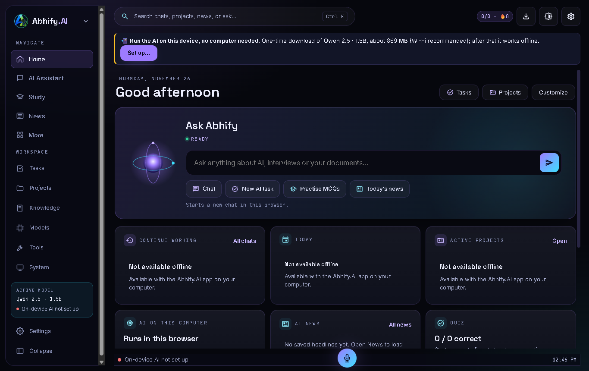
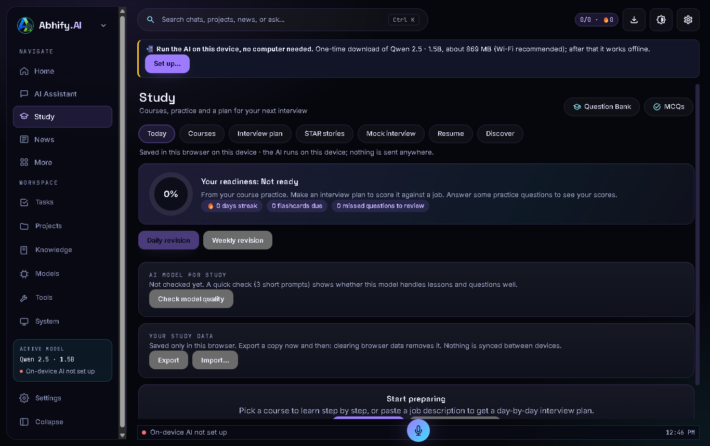
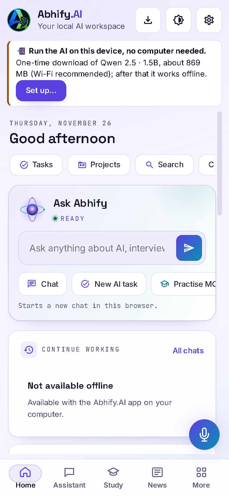
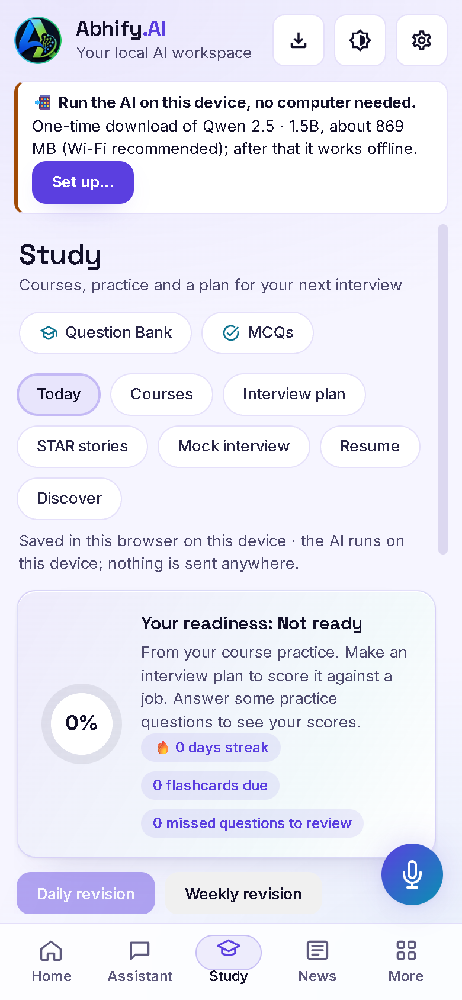
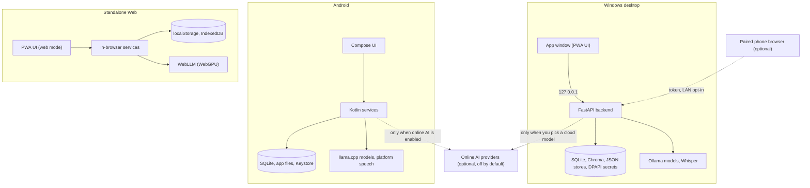
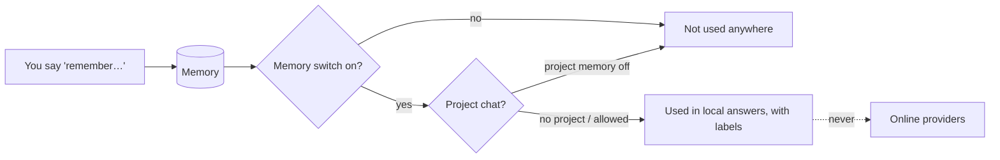
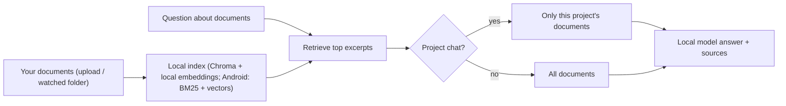
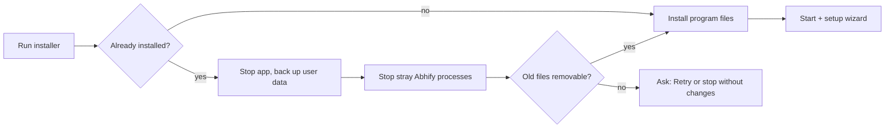

# Abhify.AI

**Your personal AI that runs on your own device: Windows, Android and the browser.**

### ▶️ [Try it in your browser: tabhiabhishek.github.io/Abhify.AI](https://tabhiabhishek.github.io/Abhify.AI/)

There's nothing to install. The AI runs inside your browser on your own device, and your data never leaves it. Use a recent Chrome or Edge with WebGPU. The first chat asks before a one-time model download (about 869 MB).

**Release `7.2.1`** is stable and has been validated on a real laptop and phone (see [Release status](#release-status)).

  
  

  
  &nbsp;&nbsp;
  

Abhify.AI is a **local-first, privacy-first personal AI workspace**. It covers chat, voice, learning and interview preparation, a personal knowledge base, news, projects and tasks. AI runs on your own device by default. Online providers are optional, off by default and used only after you configure them.

## Features

- **AI assistant on your device.** It chats with local models: Ollama on Windows, llama.cpp on Android, WebLLM in the browser. Online providers (your own keys) are optional, and what is sent to them is filtered.
- **Voice.** Talk to it and have answers read aloud. It has microphone diagnostics that tell you clearly when no sound or no speech was detected.
- **Study.** Courses, lessons and quizzes, mock interviews, resume tailoring and progress reports. On Android it adds reminders, offline packs and a home-screen widget.
- **Knowledge base (RAG).** Upload documents or watch a folder, then ask questions. Answers come with sources, and everything stays in a local index.
- **Memory with consent.** It remembers only what you ask it to. Memory can be switched off globally or per project, and it is never sent to online providers.
- **Projects and Task Runner.** Project-scoped chats, documents and memory, plus multi-step tasks run by a local agent.
- **Live news and real-time answers.** News, web, weather and currency rates, with citation checks.
- **Phone companion (optional).** Pair a phone browser with the desktop over your LAN, using a token and invite-only membership.
- **Backups and safe upgrades.** One-click backups. The installer backs up your data before every upgrade and never deletes Ollama models or your files.

It ships as **three independent installations**. They share no runtime, no database and no automatic sync:

| Platform | What you get | AI runtime | Data stays in |
|---|---|---|---|
| **Windows desktop** | Full app: Assistant, Study, News, Knowledge, Projects, Task Runner, voice, backups, optional phone companion | Ollama (local); optional online providers | `%LOCALAPPDATA%\AbhifyAI` |
| **Android** | Native app: Assistant, Study (reminders, offline packs, widget), News, documents with OCR, workspace and to-dos, Career | llama.cpp on the phone; optional online providers | App-private storage |
| **Standalone Web** | Browser app: chat, memories, Study, voice | WebLLM on WebGPU (in the browser) | This browser only |

## Architecture

There is no connection between the three installations. Encrypted Google Drive portability exists in the code but is **hidden and not connected** in 7.2.1. It is planned for 7.6, after the owner's check.

## Privacy model

- **Local by default.** Models, chats, memories, documents and study data live on the device.
- **Cloud prompts are filtered.** When you choose an online model, Abhify.AI sends it:
  - your question;
  - earlier replies from online models;
  - public live evidence (news, web, weather, FX).

  Memories, documents, local records, your name and local-model history are never sent. A question about your own records is answered locally, and no provider is called.
- **Memory needs your consent.** Memories are saved only when you ask ("remember that…") or, on Android, approve a suggestion. The memory switch, per-project memory and Study's per-course personal context all respect each other.

## Local knowledge (RAG)

Deleting an upload removes it from search and moves the original to a Trash folder, which is purged after 7 days.

## Personal AI Brain: status

| Piece | Status in 7.2.1 |
|---|---|
| Intent and focus detection, live evidence with citation checks | Implemented |
| Memory with switches, project scope, Study personal context (opt-in) | Implemented |
| Cloud-prompt filtering | Implemented (7.2.1) |
| Android memory review queue | Implemented |
| Unified consent policy, memory review on Windows and Web, unified local search, audit log | **Planned: 7.3** |

## Install

**Public availability:**
- **Web** is public. Use it at [tabhiabhishek.github.io/Abhify.AI](https://tabhiabhishek.github.io/Abhify.AI/), or host it yourself with `Abhify.AI-7.2.1-Web.zip` from [Releases](../../releases).
- **The Windows and Android packages are not published.** They stay private until production code signing is in place.

The steps below are for the owner's private builds.

**Windows:**
- Run `Abhify.AI-7.2.1-Setup.exe`. It installs per user, without admin rights.
- The setup wizard checks your hardware, then offers to install Ollama and a recommended model. Every download is confirmed first.
- Portable alternative: unzip `Abhify.AI-7.2.1-Portable.zip` and run `Start Abhify.AI.vbs`.

**Android:**
- Install `Abhify.AI-7.2.1-debug.apk` (sideload).
- To upgrade, install over the existing app. Do **not** uninstall first.

**Web (self-hosting):** serve the contents of `Abhify.AI-7.2.1-Web.zip` (the release folder's `web/standalone/`) over HTTPS or localhost. It is `frontend/` with `abhify-platform=web` and needs no backend. The first chat asks before downloading a model.

Upgrades never touch your data, which is backed up first. Ollama models are never removed.

Full steps: [docs/INSTALL.md](docs/INSTALL.md).

## Build from source

| Target | Command |
|---|---|
| Backend | Python 3.11. In `backend/`, run `python -m venv .venv`, `.venv\Scripts\pip install -r requirements.txt`, then `.venv\Scripts\python -m uvicorn main:app` |
| Windows package | `python packaging/windows/build.py` (output in `dist/windows/<version>/`) |
| Android | JDK 17. In `android/`, run `gradlew --offline testDebugUnitTest lintDebug assembleDebug` |
| Tests | `backend\.venv\Scripts\python -m pytest backend/tests -q`. Node.js 22 is needed for the JS harnesses |

## Release status

| Item | State |
|---|---|
| Automated tests | Backend, JS harnesses, Android unit tests and lint, browser E2E, privacy captures, Windows Sandbox install and upgrade. Results: [final release report](docs/ABHIFY_7_2_1_FINAL_RELEASE_REPORT.md) |
| Physical validation | **Passed** (owner-reported, 2026-11-26): laptop checklist W1–W14, phone checklist A1–A8 |
| Signing | Android: development certificate. Windows: unsigned. See [signing guide](docs/SIGNING_GUIDE.md) |
| Feature freeze | 7.2.1 is the protected baseline. New work goes into 7.3+ milestones |

## Documentation

- **[Complete documentation](docs/ABHIFY_AI_COMPLETE_DOCUMENTATION.md)**: the canonical reference. It covers architecture, every feature with its status, data locations, database, the full API route list, security, backup, configuration, testing, limitations and the roadmap.
- [Changelog](CHANGELOG.md)
- [Roadmap](docs/ABHIFY_ROADMAP.md): recommended next enhancements and the 7.3–7.6 plan.
- [Documentation index](docs/README.md): every document in `docs/`.
- Roadmap specs: [7.3](docs/ABHIFY_7_3_PERSONAL_AI_BRAIN_SPEC.md), [7.4](docs/ABHIFY_7_4_PRODUCTIVITY_SPEC.md), [7.5](docs/ABHIFY_7_5_QUALITY_AND_TRUST_SPEC.md), [7.6](docs/ABHIFY_7_6_SYNC_SPEECH_PLUGINS_SPEC.md).

## License

No license has been specified yet (there is no LICENSE file). All rights are reserved by the owner until one is chosen. Third-party components keep their own licences: llama.cpp (MIT), Qwen2.5 (Apache-2.0), Material Icons (Apache-2.0), Inter (OFL), WebLLM (Apache-2.0), Mermaid (MIT).
