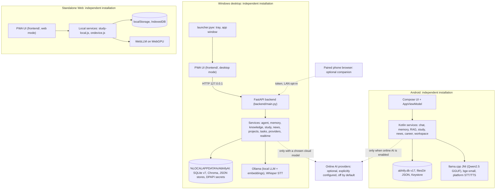
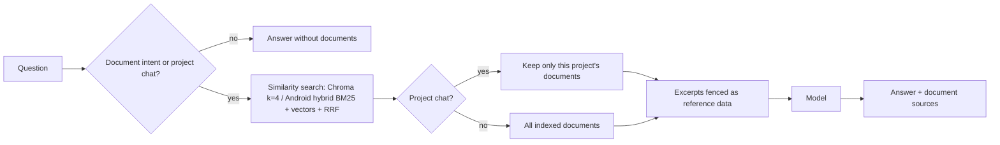
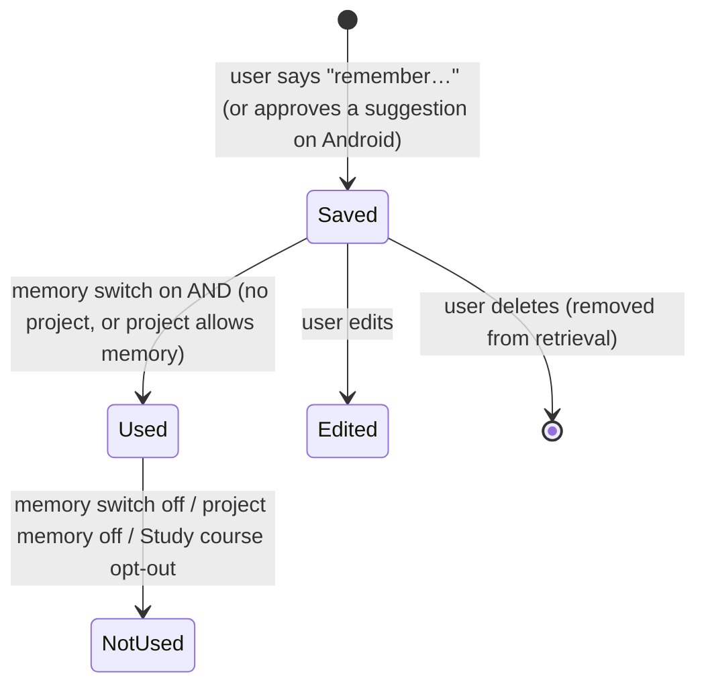
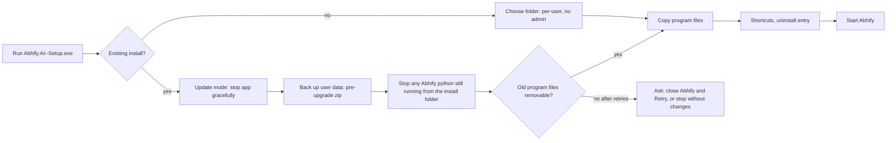

# Abhify.AI: complete documentation (release 7.2.1)

**Status of this document:** canonical. This is the authoritative technical and product description of the 7.2.1 release. It describes what the source code does today.

**How to read it:**
- Status labels are used throughout:
  - **Implemented**: in the code and tested.
  - **Partial**: in the code, incomplete or insufficiently tested.
  - **Hidden**: in the code, switched off in this build.
  - **Planned**: not in the code.
  - **Deprecated**: kept for compatibility.
- The roadmap (§31) is kept separate from implemented functionality.

**Sources:** the source tree at 7.2.1, plus the reports in `docs/`. Historical per-version reports were removed at the 7.2.1 consolidation (tracked ones remain in Git history); `docs/README.md` lists what is kept. No secrets are reproduced here.

---

## 1. Product overview and purpose

Abhify.AI is a **local-first, privacy-first personal AI workspace**. It is used for:
- learning and interview preparation;
- a personal knowledge base;
- AI-assisted productivity;
- news;
- voice conversation.

**It runs as three independent installations:**

| Installation | What it is |
|---|---|
| **Windows desktop** | A local FastAPI backend with a web UI in an app window, using Ollama models on the PC |
| **Android** | A native Kotlin/Compose app with on-device llama.cpp models |
| **Standalone Web** | A static web app, with AI running in the browser through WebGPU |

**Principles:**
- **Each installation is independent.** There is no shared runtime, no shared database and no automatic sync.
- **Local models are the default.** Online AI providers are optional, explicitly configured and off by default.
- **Personal data stays on the device** unless the user explicitly chooses otherwise.

---

## 2. Feature inventory (7.2.1)

| Area | Feature | Windows | Android | Web | Status |
|---|---|---|---|---|---|
| Assistant | Chat with local model, streaming, stop, regenerate, model choice per chat | ✓ | ✓ | chat only (no stream/stop/regenerate) | Implemented |
| Assistant | Live information (news, web, weather, FX) with citation checking | ✓ | ✓ | — | Implemented (weather/FX opt-in) |
| Assistant | Optional online providers (Gemini, Groq, OpenRouter, custom) | ✓ | ✓ (+ optional server) | — | Implemented, off by default |
| Assistant | Voice: speech-to-text, read-aloud, wake word | Whisper local, SAPI wake word (opt-in) | platform STT/TTS, Vosk wake (opt-in) | browser STT (consent) | Implemented |
| Memory | Personal memories ("remember that…"), memory switch, deletion | ✓ | ✓ (+ review queue) | ✓ (no viewer) | Implemented / Partial (Web) |
| Study | Courses (5 tracks + custom), preferences, layered lessons, tutor, unlimited MCQs, spaced repetition, dashboards, capstone | ✓ | ✓ | ✓ (on-device AI) | Implemented |
| Study | Interview plan from job description, STAR stories, mock interview, resume tailoring, progress report, model quality check, Mermaid diagrams (text on Android) | ✓ | ✓ | ✓ | Implemented |
| Study | Personal context per course (opt-in; respects memory switch) | ✓ | ✓ | ✓ (memories only) | Implemented |
| Study | Daily reminder, offline lesson packs, home-screen widget | — | ✓ (off by default) | — | Implemented |
| News | News Center: categories, search, reader, AI summary, saved list | ✓ | ✓ | cached/sample only | Implemented / Partial (Web) |
| Knowledge | Documents, folder watcher, local RAG, upload delete with Trash | ✓ | ✓ (OCR, hybrid search) | — | Implemented |
| Workspace | Projects, AI Task Runner, agent plan/apply/undo | ✓ | ✓ (+ to-dos with due dates) | — | Implemented |
| Career | MCQs from resume/topic, question bank, job match (Android) | ✓ | ✓ | legacy tabs | Implemented |
| System | Model setup and library, hardware advice, performance, diagnostics, backups, phone companion | ✓ | ✓ (setup wizard, model manager) | device model only | Implemented |
| Data | Encrypted Drive portability | code complete, **hidden** | engine only (tests) | engine only | Hidden (owner check pending) |
| Data | Study export/import | ✓ | ✓ | ✓ | Implemented |
| Brain | Unified consent, memory review on all platforms, unified search | — | partial | — | **Planned (7.3)** |

**Deprecated or legacy, kept for compatibility:**
- Windows `/news` (generators) and `brain.search`.
- Web Question Bank and MCQ tabs.
- Android old Learn screens and the "Resume Assistant (classic)".
- Android server sync (`sync/`): off by default; to be retired in 7.6 (decision D7).

---

## 3. Supported platforms

| Platform | Requirement |
|---|---|
| Windows desktop | Windows 10/11 64-bit; per-user install without admin rights; Ollama for AI (the setup wizard can install it); 8 GB RAM minimum (16 GB recommended); a GPU is optional |
| Android | Android 10+ (minSdk 29), arm64; 6–8 GB RAM recommended for the 1.5B model |
| Standalone Web | A browser with WebGPU (recent Chrome or Edge) for AI; static HTTPS hosting or localhost |

---

## 4. System architecture



There is no arrow between the three installations. The phone companion is an optional, token-protected way for a phone browser to use **the desktop's** backend. It is not a sync mechanism.

---

## 5. Frontend architecture (Windows and Web)

**Files:**

| File | Purpose |
|---|---|
| `frontend/index.html` | Shell. `<meta name="abhify-platform" content="desktop|web">` selects the mode |
| `frontend/app.js` (~4,700 lines) | Navigation (Home, Assistant, Study, News, More), chat, voice, news, knowledge, projects, tasks, settings, companion, command palette (Ctrl+K) |
| `frontend/study-ui.js` | Study tab: Today, Courses, Interview plan, STAR, Mock interview, Resume, Discover, report |
| `frontend/study-core.js` | Shared Study rules (port of `backend/study_core.py`) |
| `frontend/study-local.js` | Study without a backend: answers the same `/learn/*` routes in the browser |
| `frontend/ondevice.js` | WebLLM engine, model catalog, on-device chats and memories (IndexedDB) |
| `frontend/vault.js`, `sync-core.js`, `datasync-ui.js` | Encrypted portability (hidden) |
| `frontend/sw.js` | Service worker: shell precache; API paths are never cached; one reload per update |
| `frontend/vendor/` | Vendored, hash-pinned WebLLM and Mermaid. There are no CDN calls |

**Mode switch:**
- In Web mode `apiCandidates()` returns nothing, so the app never contacts a backend.
- Study uses `study-local.js`.
- Chat uses `deviceChat()`.

---

## 6. Backend architecture (Windows)

- **Entry:** `desktop/launcher.pyw` starts uvicorn in-process (single instance via `run/backend.json`, port memory, tray), then opens an Edge/Chrome `--app` window.
- **API:** `backend/main.py` (~218 routes).
- **Security middleware:**
  - `companion_guard`: CSRF and cross-origin guard, DNS-rebinding Host check, paired-device allow-list.
  - `local_only` dependency on admin, system and personal-data routes.
  - Path redaction for remote callers.
  - Log redaction.

| Module | Role |
|---|---|
| `agent.py` | LangGraph ReAct agent, prompt building (`_prepare`), streaming, cloud path (`stream_cloud`, `cloud_history`) |
| `memory_service.py`, `database.py` | Conversations, messages, memories (FTS5), preferences; migrations v1–v7 |
| `knowledge.py`, `document_indexer.py`, `folder_watcher.py` | Chroma index, chunking, folder watcher, upload delete with Trash |
| `realtime.py`, `citations.py` | Live evidence (news, web, weather, FX, projects, tasks, system) and citation integrity |
| `providers.py`, `secure_store.py` | Online providers (keys in DPAPI) |
| `study.py`, `study_core.py`, `study_plus.py`, `study_sync.py` | Study (storage `data/study.json`), shared rules, dev.2 extras, Drive merge rules (not connected) |
| `news_center.py` | News Center |
| `projects.py`, `task_runner.py`, `insights.py`, `brain.py`, `intelligence.py` | Workspace, task runner, home dashboard, briefing, focus |
| `system_service.py`, `hardware_advisor.py`, `setup_manager.py`, `updates.py` | Models, hardware advice, setup, signed updates (unconfigured) |
| `transcribe.py`, `wakeword.py`, `identity.py`, `model_switch.py` | Voice and identity |
| `companion.py`, `membership.py` | Phone companion |
| `datasync_*`, `vault_crypto.py`, `sync_core.py`, `drive_client.py`, `google_oauth.py` | Encrypted Drive portability (hidden) |
| `local_file_service.py` | Data root, settings, backups |

---

## 7. Android architecture

- **App shell:** a single Activity (`ui/MainActivity.kt`) with a route enum and tabs: Home, Assistant, Study, News, More.
- **State:** state lives in `ui/AppViewModel.kt` (large) plus per-area state holders.
- **App-wide singletons:** `AppGraph.kt`.

| Area | Packages |
|---|---|
| Chat and AI | `llm/LlmEngine.kt` (JNI to `cpp/abhify_llm.cpp`), `ai/HybridAi.kt` (routing DEVICE/AUTO/ONLINE), `providers/`, `chat/PromptBuilder.kt`, `intel/` (Brain planner, Realtime, Citations) |
| Memory | `memory/MemoryKit.kt` (retrieval, sensitive check), `memory/MemoryReview.kt` (review queue) |
| Knowledge | `docs/` (Library BM25, RagIndex, Retrieval RRF, Embeddings), `ocr/` (ML Kit, consent) |
| Study | `learn/StudyCore.kt`, `StudyService.kt`, `StudyWork.kt` (reminder, packs), `StudyWidget.kt`; old Learn (`Srs.kt`, `Studio.kt`) |
| Others | `news/`, `career/`, `workspace/`, `task/`, `agent/`, `voice/`, `device/`, `model/`, `backup/`, `drive/`, `vault/` (engine only), `sync/` (legacy server sync, off) |

**Data:**
- `abhify.db` (ChatDb **v17**, additive migrations V3–V17).
- `filesDir`: `study.json`, `tasks.json`, `projects.json`, `career_mcq.json`, …
- Keystore aliases: session, provider keys, backup passphrase.
- `allowBackup=false`.

**Permissions (7.2.1):**
- INTERNET, ACCESS_NETWORK_STATE.
- FOREGROUND_SERVICE, FOREGROUND_SERVICE_DATA_SYNC.
- POST_NOTIFICATIONS: asked when needed.
- RECORD_AUDIO: asked on tap.
- Plus permissions added by libraries.
- `REQUEST_INSTALL_PACKAGES` was **removed** in 7.2.1.

---

## 8. Standalone Web architecture

| Concern | How it works |
|---|---|
| Runtime | No backend. All data is in this browser. AI is WebLLM on WebGPU after a **confirmed** download (size shown, storage checked) |
| Works | Chat, memories ("remember that…"), Study (complete, `study-local.js`), voice through browser speech recognition (consent notice), read-aloud, theme and layout |
| Desktop-only | Knowledge, Projects, Task Runner, live News, Discover, memory viewer. This is decision D10 |
| Data loss risk | Clearing site data removes everything; Study offers Export |

---

## 9. Personal AI Brain: architecture and implementation status

**Target design:** `docs/PERSONAL_AI_BRAIN_STRATEGIC_ARCHITECTURE.md`. It covers:
- intent, context resolver, consent policy, memory, retrieval, planner, model router, tool registry, approval, history.

**Implemented in 7.2.1 (pieces of that design):**
- Intent and focus detection (`intelligence.py`, `intel/Brain.kt`).
- Live-evidence resolver (`realtime`).
- Memory retrieval with switches.
- Project-scoped context.
- Study per-course opt-in context with "Used:" labels.
- Agent tool typing: READ / REVERSIBLE / SENSITIVE refused.
- Cloud-prompt filtering: since 7.2.1, local records, memories, documents, the user name and local-model history are never sent online.

**Not implemented (planned for 7.3, not started):**
- Unified ConsentPolicy and grants.
- Memory review on Windows and Web.
- Unified local search.
- Audit log.

```mermaid
sequenceDiagram
  participant U as User
  participant UI as Screen
  participant A as agent._prepare / AppViewModel.answer
  participant M as Memory (switch + project scope)
  participant K as Knowledge (project-scoped in project chats)
  participant R as Realtime (external-only for cloud)
  participant L as Model (local default; cloud only if chosen)
  U->>UI: message
  UI->>A: text + model + project
  A->>M: memories (only if memory on and project allows)
  A->>K: documents (when asked or in project)
  A->>R: live evidence if needed
  A->>L: prompt
  L-->>UI: answer + sources + context labels
```

---

## 10. Local AI models: installation, selection, execution

| Platform | Runtime | Models | Installation | Selection |
|---|---|---|---|---|
| Windows | **Ollama** (local HTTP) | Profiles in `system_service.py`: Minimal `qwen2.5:1.5b`, Balanced `qwen2.5` (7B), Quality `qwen2.5:14b`; embeddings `nomic-embed-text`. Catalog with registry digests: `backend/model_catalog.json` | Setup wizard and Model Library. Downloads need **confirmation** (size shown). The Ollama installer is Authenticode-checked | `hardware_advisor` recommends by RAM/VRAM. The user picks a default and can pick per chat; it is never silently swapped. `LLM_MODEL` / `EMBED_MODEL` env overrides |
| Android | **llama.cpp** (JNI, CPU; Vulkan only per validated model) | `assets/model_catalog.json`: Qwen2.5 1.5B and 0.5B Instruct Q4_K_M (pinned revision and SHA-256); embeddings bge-small (optional) | Setup wizard and Models screen. Resumable download, SHA-256 verified, then a real self-test answer before activation | `ModelSelector` (RAM/storage margins), `GpuPolicy` per model, `ai_mode` DEVICE/AUTO/ONLINE |
| Web | **WebLLM** (WebGPU) | Qwen2.5 1.5B, Llama 3.2 1B (`ondevice.js` MODELS) | Confirm dialog, storage check, persistent storage request | Chosen by device capability |

**Model quality check** (Study): 3 fixed probes per model, giving good, weak or poor. It never blocks a model.

---

## 11. Chat and assistant

- **Prompt building:**
  - system prompt + identity + preferences;
  - memories, when the memory switch is on;
  - document excerpts, on document intent or in project mode;
  - project brief;
  - live evidence.
- **Tools** (local models only, intent-gated): `knowledge_base_search`, `search_memory`, `save_memory` (explicit request only), `web_search`.
- **Turns with live evidence** run with no tools.
- **Citations** are checked after generation. An invalid source is removed; an unsupported claim is marked.
- **Cloud models** are sent only:
  - the question;
  - previous exchanges that a cloud model answered;
  - external live evidence (news, web, weather, FX).
- **A question that needs local records** is answered by the app itself, and the provider is not called.
- **Voice:**
  - Desktop: Whisper speech-to-text and browser read-aloud.
  - Microphone level handling (7.2.1): faint speech is transcribed. Only true silence produces "No sound reached Abhify.AI…", with the mute key and Windows privacy hints.
  - Wake word: opt-in, and paused after each update.

---

## 12. Study and learning

**Spec:** `docs/specs/ABHIFY_STUDY_V1.md`.

**Shared rules and checks:**
- One set of rules exists in three implementations: `study_core.py`, `study-core.js` and `StudyCore.kt`.
- They are checked against `backend/tests/data/study_cases.json`, regenerated with `python backend/tests/make_study_cases.py`.

**Storage:**
- One JSON file: `data/study.json` (Windows), `filesDir/study.json` (Android), localStorage `abhify.study.v1` (Web).
- Schema 1. Writes are atomic, with a `.bak` copy. An unreadable file is kept aside as `study.corrupt-*.json`, and a newer schema is refused.

**AI:** local only; on Windows a cloud choice falls back to the local default.

**Personal context:** opt-in per course, using only the ticked items. It is empty whenever the global memory switch is off (7.2.1); the ticked items are kept.

---

## 13. News

`news_center.py` / `news/NewsCenter.kt`:
- RSS catalog (`news_sources.json`), Google News search, reader with summary.
- The AI summary uses no tools, no memory and no history.
- Content is fenced as untrusted data.
- The Web build shows cached or sample stories only.

---

## 14. Knowledge Center and documents

**Windows:**
- Uploads (`/knowledge/upload`: pdf, txt, md) and a watched folder (txt, md, py, pdf; secrets and VCS folders skipped).
- Chroma collection `knowledge_base` with `nomic-embed-text`; chunks of 1,000 characters with 150 overlap.
- Changing the embedding model requires a rebuild; the old index is kept until the new one is validated.
- **Delete (7.2.1):** `DELETE /knowledge/documents/{name}?confirm=true` (this computer only). It removes the chunks, the record and project references, and moves the original to `data/documents/trash/<date>/`. Trash is purged after 7 days.
- Documents are **shared knowledge** by design. Project chats are additionally limited to their own documents (owner decision, 2026-11-25).

**Android:**
- `library_docs`, `doc_chunks` (+ FTS4), `chunk_vectors`.
- Hybrid BM25 + cosine with RRF.
- OCR with consent.
- Online use of document text only with per-session consent.

---

## 15. Local RAG and semantic search



**Unified search across chats, lessons and stories:**

| Platform | State |
|---|---|
| Windows `/search` | Names and metadata only (Partial) |
| Android UnifiedSearch | SQL LIKE across 10 types (Partial) |
| Unified semantic search | Planned (7.3) |

---

## 16. Memory and privacy controls



| Control | Windows | Android | Web |
|---|---|---|---|
| Memory on/off | `memory_enabled` | `memories_enabled` | — |
| Chat history saving and retention | `save_history`, `history_retention_days` | — | — |
| Project memory | `use_memory` (also enforced in the memory tools, 7.2.1) | `useMemory` | — |
| Online | Memories, documents, local records and user name never sent; only cloud-answered history | `online_ai_allowed` (off), `online_ai_memories` (off), `online_history` (off for new installs since 7.2.1), `knowledge_online` (off) | none |

Android also has a memory review queue (conflict, duplicate, expiring, stale) and approval of suggestions.

---

## 17. Projects and tasks

**Windows:**
- Projects (`data/projects.json`; references to documents; recorded status).
- AI Task Runner (`data/tasks.json`; templates summary, study, quiz, news, custom).
- Agent plan/apply/undo: SENSITIVE actions are refused, REVERSIBLE ones need approval.
- There are **no to-dos with due dates** on Windows; these are planned for 7.4.

**Android:**
- Workspaces, notes and **to-dos with due dates**, with reminders.
- Projects and the Task Runner, unified search, agent tools.

---

## 18. Career and interview preparation

| Platform | What it has |
|---|---|
| Windows / Web | Career MCQs (document, topic, mixed), Study interview plan, STAR coaching, mock interview, resume tailoring (fact guard: no added numbers or skills) |
| Android | Also a full Career tab: resumes, job descriptions, match engine, interview practice, PDF/DOCX export. Resume text goes online only with consent |

---

## 19. Settings and system management

| Area | Windows | Android |
|---|---|---|
| Models and setup | Setup wizard, Model Library | Setup wizard, Models screen |
| System | Providers, Performance, System & data (diagnostics, backups, data location, updates) | Providers, storage, memory review |
| Phone access | Phone companion (off by default; pairing tokens; LAN opt-in) | — |
| Personalisation | Voice settings, wake word, assistant name and voice personalisation | Same |
| Backup | Desktop backups | Backup (optional AES-GCM), Drive (BackupPolicy: no plaintext automatic uploads) |

---

## 20. Platform independence and data locations

| Platform | Data location | Program location |
|---|---|---|
| Windows | `%LOCALAPPDATA%\AbhifyAI\`:<br>`data/abhify.db`<br>`data/chroma/`<br>`data/documents/uploads/`<br>`data/documents/trash/`<br>`data/*.json` (projects, tasks, career_mcq, study, agent_runs)<br>`data/backups/`<br>`config/settings.json`<br>`secrets/` (DPAPI)<br>`cache/news/`<br>`run/backend.json`<br>Override: `ABHIFY_DATA_DIR` | `%LOCALAPPDATA%\Programs\Abhify.AI\` (`runtime\`, `app\`) |
| Android | App-private storage:<br>`databases/abhify.db`<br>`files/*.json`<br>`no_backup/models/`, `vosk/` | — |
| Web | This browser's localStorage and IndexedDB for this site; the WebLLM model cache | — |

**Ollama models** (Windows) are stored by Ollama itself, typically in `%USERPROFILE%\.ollama`. They are never touched by Abhify install, upgrade or uninstall.

---

## 21. Database architecture

### Windows SQLite migrations

Append-only, backed up before migrating, rolled back on failure:

| Version | Adds |
|---|---|
| v1 | events |
| v2 | conversations, messages, memories (+ FTS5), app_settings, documents |
| v3 | FTS5 stemming |
| v4 | documents rebuilt (path_key, retries, embed_model) |
| v5 | members, invitations |
| v6 | model per conversation and message |
| v7 | sync_map, sync_meta, sync_stash |

### JSON stores

`projects.json`, `tasks.json`, `career_mcq.json`, `study.json` (schema 1), `agent_runs.json`.

### Android ChatDb

**v17**, additive SchemaV3–V17. It covers:
- conversations and messages (FTS4);
- memories (category, importance, confirmed, source, expires_at, use stats);
- library_docs, doc_chunks, chunk_vectors;
- workspaces, notes, tasks;
- career tables;
- Drive tables;
- saved_prompts.

### Integrity tool

`backend/tools/integrity_report.py` is read-only. It records row counts and SHA-256 per table and JSON store, plus the Chroma logical content.

---

## 22. API architecture (Windows backend)

**Base and access:**
- Base URL: `http://127.0.0.1:<port>` (port remembered; default 8000).
- **This computer only** routes use `local_only`.
- Other routes are reachable from paired phones only if they are on the companion allow-list (`companion.py`).
- OpenAPI docs: `/docs` (this computer only).

The complete route list below is generated from the running app's route table at 7.2.1:

Total: 213 method+path entries in 35 groups.

#### `/agent`

| Method | Path | Access | Purpose |
|---|---|---|---|
| GET | `/agent/tools` | this computer only | The agent's typed tool registry (READ / REVERSIBLE / SENSITIVE) and its workflows. |
| POST | `/agent/plan` | this computer only | Read-only planning: sections with sources and proposals with ids. Nothing is changed. |
| POST | `/agent/apply` | this computer only | Applies only the approved REVERSIBLE proposals of a plan (link a document, add a next action) and verifies eac |
| POST | `/agent/undo` | this computer only | Reverts exactly what that run applied. |

#### `/backup`

| Method | Path | Access | Purpose |
|---|---|---|---|
| GET | `/backup` | this computer only |  |
| POST | `/backup` | this computer only |  |
| GET | `/backup/export` | this computer only |  |
| POST | `/backup/restore` | this computer only |  |

#### `/briefing`

| Method | Path | Access | Purpose |
|---|---|---|---|
| GET | `/briefing` | this computer only | Next build: the personal briefing from local records only (projects, failed AI tasks, MCQ practice, last saved |

#### `/career`

| Method | Path | Access | Purpose |
|---|---|---|---|
| POST | `/career/mcq` | this computer only | One validated batch of personalised MCQs (resume/document, topic or both). Ask again for more: nothing repeats |
| POST | `/career/mcq/answer` | this computer only |  |
| GET | `/career/mcq/stats` | this computer only |  |

#### `/chat`

| Method | Path | Access | Purpose |
|---|---|---|---|
| POST | `/chat` | this computer; paired phones only if allow-listed |  |
| POST | `/chat/stream` | this computer; paired phones only if allow-listed | The same chat as /chat, streamed as newline-delimited JSON: {"type":"token","text"} … then {"type":"done", …}. |
| POST | `/chat/warm` | this computer; paired phones only if allow-listed | Called when the microphone starts: loads the chat model that will answer (the chosen one, never another) and,  |

#### `/companion`

| Method | Path | Access | Purpose |
|---|---|---|---|
| GET | `/companion` | this computer; paired phones only if allow-listed |  |
| POST | `/companion/redeem` | this computer; paired phones only if allow-listed | A phone turns a single-use invitation into its own device credential (returned once). |
| POST | `/companion/register` | this computer; paired phones only if allow-listed | Public mode only: register this device as a restricted member. |
| GET | `/companion/admin` | this computer only | Everything the owner's membership screen shows. No secrets, no hashes. |
| GET | `/companion/invitations` | this computer only |  |
| POST | `/companion/invitations` | this computer only |  |
| POST | `/companion/invitations/{inv_id}/revoke` | this computer only |  |
| GET | `/companion/members` | this computer only |  |
| POST | `/companion/members/{member_id}/revoke` | this computer only |  |
| POST | `/companion/registration-mode` | this computer only |  |
| POST | `/companion/lan-access` | this computer only | Listen on all network interfaces (plain Wi-Fi HTTP) after the next restart. Off by default: |
| POST | `/companion/enable` | this computer only |  |
| POST | `/companion/disable` | this computer only |  |

#### `/conversations`

| Method | Path | Access | Purpose |
|---|---|---|---|
| GET | `/conversations` | this computer; paired phones only if allow-listed |  |
| GET | `/conversations/{conversation_id}` | this computer; paired phones only if allow-listed |  |
| DELETE | `/conversations/{conversation_id}` | this computer; paired phones only if allow-listed |  |
| DELETE | `/conversations` | this computer; paired phones only if allow-listed |  |

#### `/datasync`

| Method | Path | Access | Purpose |
|---|---|---|---|
| GET | `/datasync/status` | this computer only |  |
| PUT | `/datasync/oauth-client` | this computer only |  |
| POST | `/datasync/connect` | this computer only |  |
| POST | `/datasync/connect/finish` | this computer only |  |
| POST | `/datasync/disconnect` | this computer only |  |
| POST | `/datasync/interop-check` | this computer only |  |
| GET | `/datasync/vault` | this computer only |  |
| POST | `/datasync/vault/create` | this computer only |  |
| POST | `/datasync/vault/confirm` | this computer only |  |
| POST | `/datasync/vault/join` | this computer only |  |
| PUT | `/datasync/kinds` | this computer only |  |
| POST | `/datasync/preview` | this computer only |  |
| POST | `/datasync/apply` | this computer only |  |
| GET | `/datasync/conflicts` | this computer only |  |
| POST | `/datasync/conflicts/{cid}` | this computer only |  |
| GET | `/datasync/deleted` | this computer only |  |
| POST | `/datasync/deleted/{tid}/restore` | this computer only |  |
| GET | `/datasync/history` | this computer only |  |
| GET | `/datasync/devices` | this computer only |  |
| POST | `/datasync/devices/{dev}/revoke` | this computer only |  |
| POST | `/datasync/identity/reset` | this computer only |  |
| GET | `/datasync/backups` | this computer only |  |
| GET | `/datasync/backups/drive` | this computer only |  |
| POST | `/datasync/backups` | this computer only |  |
| GET | `/datasync/backups/{name}` | this computer only |  |
| POST | `/datasync/backups/drive/{file_id}/fetch` | this computer only |  |
| POST | `/datasync/restore/preview` | this computer only |  |
| POST | `/datasync/restore/apply` | this computer only |  |

#### `/discover`

| Method | Path | Access | Purpose |
|---|---|---|---|
| GET | `/discover` | this computer only | Next build: Study → Discover (live MIT OCW, OpenStax, Wikibooks + provider search links; cost only as the sour |

#### `/eval`

| Method | Path | Access | Purpose |
|---|---|---|---|
| GET | `/eval/retrieval` | this computer only | 5.6: local AI-quality check on a built-in synthetic set (no user data): precision@k of search and related docu |

#### `/generate-mcq`

| Method | Path | Access | Purpose |
|---|---|---|---|
| POST | `/generate-mcq` | this computer; paired phones only if allow-listed |  |

#### `/generate-question`

| Method | Path | Access | Purpose |
|---|---|---|---|
| POST | `/generate-question` | this computer; paired phones only if allow-listed |  |

#### `/health`

| Method | Path | Access | Purpose |
|---|---|---|---|
| GET | `/health` | this computer; paired phones only if allow-listed |  |

#### `/identity`

| Method | Path | Access | Purpose |
|---|---|---|---|
| GET | `/identity` | this computer only | 7.1.0-dev.2: the assistant's name on this computer, the default, suggestions and the wake phrases it implies. |

#### `/knowledge`

| Method | Path | Access | Purpose |
|---|---|---|---|
| POST | `/knowledge/upload` | this computer; paired phones only if allow-listed |  |
| GET | `/knowledge` | this computer; paired phones only if allow-listed |  |
| GET | `/knowledge/status` | this computer; paired phones only if allow-listed |  |
| DELETE | `/knowledge/documents/{name}` | this computer only | 7.2.1: delete a document added through the app: removed from search and answers now, the file kept in Trash fo |
| GET | `/knowledge/files` | this computer; paired phones only if allow-listed |  |
| PUT | `/knowledge/folder` | this computer only |  |
| POST | `/knowledge/watcher/start` | this computer only |  |
| POST | `/knowledge/watcher/stop` | this computer only |  |
| POST | `/knowledge/watcher/pause` | this computer only |  |
| POST | `/knowledge/watcher/resume` | this computer only |  |
| POST | `/knowledge/rescan` | this computer only |  |
| POST | `/knowledge/retry` | this computer only |  |
| POST | `/knowledge/rebuild` | this computer only |  |
| POST | `/knowledge/rebuild/cleanup` | this computer only |  |

#### `/learn`

| Method | Path | Access | Purpose |
|---|---|---|---|
| GET | `/learn/tracks` | this computer only |  |
| GET | `/learn/state` | this computer only | Everything the Study tab shows: courses with progress, the plan, readiness, today's items, streak, due reviews |
| GET | `/learn/courses/{cid}` | this computer only |  |
| POST | `/learn/courses` | this computer only |  |
| DELETE | `/learn/courses/{cid}` | this computer only |  |
| POST | `/learn/lesson` | this computer only |  |
| POST | `/learn/lesson/done` | this computer only |  |
| POST | `/learn/mcq` | this computer only | One more batch for a course (the Study tab asks again as the list scrolls to the end). |
| POST | `/learn/mcq/answer` | this computer only |  |
| PUT | `/learn/courses/{cid}/prefs` | this computer only | Goal and level for this course. Changing them later keeps all progress; the overview is rebuilt. |
| GET | `/learn/prefs/options` | this computer only |  |
| POST | `/learn/courses/{cid}/overview` | this computer only |  |
| GET | `/learn/courses/{cid}/dashboard` | this computer only |  |
| POST | `/learn/courses/{cid}/time` | this computer only |  |
| POST | `/learn/courses/{cid}/exercise` | this computer only |  |
| POST | `/learn/courses/{cid}/cards` | this computer only |  |
| GET | `/learn/cards` | this computer only |  |
| POST | `/learn/cards/{card_id}` | this computer only |  |
| POST | `/learn/courses/{cid}/capstone` | this computer only |  |
| POST | `/learn/courses/{cid}/capstone/step` | this computer only |  |
| POST | `/learn/courses/{cid}/tutor` | this computer only |  |
| GET | `/learn/export` | this computer only | Your Study data as one JSON file (courses, progress, lessons, cards, plan, stories). Saved where you choose. |
| POST | `/learn/import` | this computer only |  |
| GET | `/learn/brain/sources` | this computer only | What can be shared with a course (goal memories, other memories, projects). Nothing is shared until chosen. |
| PUT | `/learn/courses/{cid}/brain` | this computer only |  |
| GET | `/learn/quality` | this computer only |  |
| POST | `/learn/quality` | this computer only |  |
| POST | `/learn/resume/tailor` | this computer only | Rewrites the most relevant resume bullets for a job, keeping only facts already in the resume. Nothing is stor |
| POST | `/learn/mock` | this computer only |  |
| GET | `/learn/mock` | this computer only |  |
| GET | `/learn/mock/{sid}` | this computer only |  |
| POST | `/learn/mock/{sid}/answer` | this computer only |  |
| POST | `/learn/mock/{sid}/finish` | this computer only |  |
| DELETE | `/learn/mock/{sid}` | this computer only |  |
| GET | `/learn/review` | this computer only |  |
| POST | `/learn/plan` | this computer only |  |
| DELETE | `/learn/plan` | this computer only |  |
| POST | `/learn/plan/item` | this computer only |  |
| GET | `/learn/stories` | this computer only |  |
| POST | `/learn/stories` | this computer only |  |
| DELETE | `/learn/stories/{sid}` | this computer only |  |
| POST | `/learn/stories/{sid}/coach` | this computer only |  |

#### `/memory`

| Method | Path | Access | Purpose |
|---|---|---|---|
| GET | `/memory` | this computer; paired phones only if allow-listed |  |
| POST | `/memory` | this computer; paired phones only if allow-listed |  |
| PATCH | `/memory/{memory_id}` | this computer; paired phones only if allow-listed |  |
| DELETE | `/memory/{memory_id}` | this computer; paired phones only if allow-listed |  |
| DELETE | `/memory` | this computer; paired phones only if allow-listed |  |

#### `/models`

| Method | Path | Access | Purpose |
|---|---|---|---|
| GET | `/models` | this computer only | Chat models installed in Ollama and the default for new chats (for the chat's model picker); 7.1: plus the sel |
| PUT | `/models/default` | this computer only |  |
| PUT | `/models/conversation/{conversation_id}` | this computer only | 7.0: this conversation's model (the chat's model picker). Checked against Ollama; a failure keeps the previous |
| DELETE | `/models/{name:path}` | this computer only | 7.0 Model Library: removes an installed Ollama model. Needs confirm=true; the default chat model and the |

#### `/news`

| Method | Path | Access | Purpose |
|---|---|---|---|
| GET | `/news` | this computer; paired phones only if allow-listed |  |
| GET | `/news/categories` | this computer; paired phones only if allow-listed |  |
| GET | `/news/article/{article_id}` | this computer; paired phones only if allow-listed | In-app reading of one story: its own text (when the publisher's page is readable) and a summary of exactly tha |
| GET | `/news/feed` | this computer; paired phones only if allow-listed |  |
| GET | `/news/search` | this computer; paired phones only if allow-listed |  |
| PUT | `/news/prefs` | this computer only |  |
| POST | `/news/ai` | this computer; paired phones only if allow-listed | Briefing / summary / explanation on the local model, from the stories already retrieved (no tools, history or  |

#### `/ping`

| Method | Path | Access | Purpose |
|---|---|---|---|
| GET | `/ping` | this computer; paired phones only if allow-listed | Instant liveness + identity check (no Ollama or network probes). Used by the desktop launcher. |

#### `/plan`

| Method | Path | Access | Purpose |
|---|---|---|---|
| GET | `/plan` | this computer only | 5.5: today's plan from projects' recorded issues and next actions (no invented deadlines). |

#### `/preferences`

| Method | Path | Access | Purpose |
|---|---|---|---|
| GET | `/preferences` | this computer; paired phones only if allow-listed |  |
| PUT | `/preferences` | this computer; paired phones only if allow-listed |  |

#### `/progress`

| Method | Path | Access | Purpose |
|---|---|---|---|
| GET | `/progress/{user_id}` | this computer; paired phones only if allow-listed |  |
| POST | `/progress` | this computer; paired phones only if allow-listed |  |

#### `/projects`

| Method | Path | Access | Purpose |
|---|---|---|---|
| GET | `/projects` | this computer only |  |
| POST | `/projects` | this computer only |  |
| GET | `/projects/{pid}` | this computer only |  |
| PATCH | `/projects/{pid}` | this computer only |  |
| POST | `/projects/{pid}/archive` | this computer only |  |
| DELETE | `/projects/{pid}` | this computer only | Removes the project record only; documents, knowledge, chats and task history are kept. Needs confirm=true. |
| POST | `/projects/{pid}/documents` | this computer only |  |
| DELETE | `/projects/{pid}/documents` | this computer only | Removes the association only; the document stays in your knowledge index. |
| GET | `/projects/{pid}/export` | this computer only |  |
| GET | `/projects/{pid}/overview` | this computer only | 5.6: read-only Status overview (recorded status and its age, milestones, blockers, decisions, next actions, |

#### `/providers`

| Method | Path | Access | Purpose |
|---|---|---|---|
| GET | `/providers` | this computer only | Cloud providers: state, masked key, models, router and the privacy rules. Keys are never returned. |
| PUT | `/providers/custom/endpoint` | this computer only | A custom OpenAI-compatible endpoint (https, or a server on this computer); tested before it is saved. |
| PUT | `/providers/router` | this computer only |  |
| PUT | `/providers/{pid}/key` | this computer only | Tests the key with the provider (its model list: free) and saves it, encrypted, only if it works. |
| POST | `/providers/{pid}/test` | this computer only |  |
| PUT | `/providers/{pid}` | this computer only |  |
| DELETE | `/providers/{pid}` | this computer only | Deletes the provider's key and settings. |

#### `/realtime`

| Method | Path | Access | Purpose |
|---|---|---|---|
| GET | `/realtime/status` | this computer only | Each live connector's state (ready / off / needs_key / offline / error) and why, and the settings. Never a key |
| PUT | `/realtime/settings` | this computer only |  |
| POST | `/realtime/lookup` | this computer only | What a chat question would retrieve (resolve + connectors), without calling the model: {needed, state, sources |

#### `/search`

| Method | Path | Access | Purpose |
|---|---|---|---|
| GET | `/search` | this computer only | Next build: one local search (conversations, memories only when memory is on, projects, AI tasks, knowledge fi |

#### `/setup`

| Method | Path | Access | Purpose |
|---|---|---|---|
| GET | `/setup/profiles` | this computer only |  |
| POST | `/setup/profile` | this computer only |  |
| POST | `/setup/models/pull` | this computer only |  |
| GET | `/setup/models/pull` | this computer only |  |
| POST | `/setup/models/pull/cancel` | this computer only | 7.0 Model Library: stops a running download (Ollama keeps the partial download, so Download resumes it). |
| POST | `/setup/test` | this computer only |  |
| GET | `/setup/advice` | this computer only | 7.0.2: this computer's hardware (each fact labelled verified / estimate / unavailable) and the recommended loc |
| POST | `/setup/use-model` | this computer only | 7.0.2: the user chose this (installed) model: run a REAL local inference first; only if it answers does it bec |
| GET | `/setup/plan` | this computer only | What automatic setup would install on this device (sizes, disk, internet). Downloads nothing. |
| POST | `/setup/auto` | this computer only | Start (or resume / retry) automatic setup after the user confirmed the plan. |
| GET | `/setup/auto` | this computer only |  |
| POST | `/setup/auto/pause` | this computer only |  |
| POST | `/setup/auto/cancel` | this computer only |  |
| POST | `/setup/complete` | this computer only |  |

#### `/skills`

| Method | Path | Access | Purpose |
|---|---|---|---|
| GET | `/skills` | this computer only | 5.5: skill levels from MCQ answers (none below min_answers), trend from the last 10 answers. |

#### `/suggestions`

| Method | Path | Access | Purpose |
|---|---|---|---|
| GET | `/suggestions` | this computer only | 5.2 Home: "continue working" and suggestions from your projects and AI tasks (records only, computed on reques |

#### `/system`

| Method | Path | Access | Purpose |
|---|---|---|---|
| GET | `/system/performance` | this computer only | One real sample: CPU, RAM, NVIDIA GPU/VRAM, models loaded in Ollama, speed of the last answer. |
| GET | `/system/diagnostics` | this computer only |  |
| POST | `/system/data-location` | this computer only |  |
| GET | `/system/update-check` | this computer only |  |
| POST | `/system/shutdown` | this computer only |  |

#### `/tasks`

| Method | Path | Access | Purpose |
|---|---|---|---|
| GET | `/tasks/templates` | this computer only |  |
| GET | `/tasks/sources` | this computer only |  |
| GET | `/tasks` | this computer only |  |
| POST | `/tasks` | this computer only |  |
| GET | `/tasks/{task_id}` | this computer only |  |
| POST | `/tasks/{task_id}/run` | this computer only |  |
| POST | `/tasks/{task_id}/retry/{step_id}` | this computer only |  |
| POST | `/tasks/{task_id}/cancel` | this computer only |  |
| DELETE | `/tasks/{task_id}` | this computer only |  |
| POST | `/tasks/{task_id}/save` | this computer only | Saves one finished result to Knowledge. Requires confirm=true (an explicit choice); never personal memory. |

#### `/transcribe`

| Method | Path | Access | Purpose |
|---|---|---|---|
| POST | `/transcribe` | this computer; paired phones only if allow-listed |  |

#### `/updates`

| Method | Path | Access | Purpose |
|---|---|---|---|
| GET | `/updates` | this computer only |  |
| POST | `/updates/check` | this computer only |  |
| POST | `/updates/download` | this computer only |  |
| POST | `/updates/cancel` | this computer only |  |
| POST | `/updates/install` | this computer only |  |
| POST | `/updates/models/check` | this computer only |  |
| POST | `/updates/models/apply` | this computer only |  |
| POST | `/updates/models/remove-backup` | this computer only |  |

#### `/voice`

| Method | Path | Access | Purpose |
|---|---|---|---|
| GET | `/voice/status` | this computer; paired phones only if allow-listed | 7.1: the local speech engine: library present, model installed (checked offline), download size and progress. |
| POST | `/voice/model/download` | this computer only | 7.1: downloads the local speech model ONLY when the user confirmed it (the size is shown first). Runs in the b |
| GET | `/voice/wake` | this computer only | Wake-phrase settings and engine state. The open page calls this about once a second with visible=1: the engine |
| PUT | `/voice/wake` | this computer only | Turning the wake phrase on needs confirm=true (the page explains microphone use first). Off by default; after  |
| POST | `/voice/wake/pause` | this computer only | Stop listening now (until Resume or the next app start); the setting stays on. |
| POST | `/voice/wake/resume` | this computer only | The page finished the interaction that a detection started: listen for the wake phrase again. |
| POST | `/voice/wake/test` | this computer only | "Test my wake phrase": listens for a few seconds and says whether the phrase was recognised. Nothing is kept. |
| POST | `/voice` | this computer; paired phones only if allow-listed |  |

---

## 23. Security, consent and privacy safeguards

- **Network exposure:**
  - Binds to 127.0.0.1 by default.
  - LAN only with companion LAN access (confirmed).
  - CORS has an explicit origin list.
  - Cross-site requests are rejected.
  - Loopback Host check (DNS rebinding).
- **Secrets:**
  - Windows: DPAPI. Android: Keystore. Never in backups or logs (log redaction).
- **Confirmation required** for: downloads, deletions, rebuilds, LAN, public registration, wake word, cloud provider first use, and restore.
- **Online AI:**
  - Off by default, with per-provider consent.
  - Charged models only with explicit allowance.
  - No fallback between providers.
  - Cloud prompts filtered (§11), verified with a request-capture test.
- **Untrusted content** (documents, news, web pages, task sources) is fenced and treated as data. Tool use is disabled when live evidence is present.
- **Study and memory:** memories are only created on explicit request or approval. Study personal context is opt-in per course and respects the memory switch.
- **Android:** `allowBackup=false`. Drive automatic uploads are never plaintext. No unused permissions (7.2.1).
- **Threat model:** `docs/ABHIFY_SECURITY_THREAT_MODEL.md`.

---

## 24. Offline functionality

Everything below works without internet once the required models are downloaded:
- local chat and voice: Whisper on Windows; platform speech recognition on Android may need its offline language pack;
- memories, Study (lessons need the model), knowledge search, projects and tasks;
- backups and settings.

Live news, web, weather and FX, and online providers, need a network. The app reports this honestly rather than inventing answers.

---

## 25. Installation and upgrade

### Windows



- **Fresh install:** run the installer, accept the defaults, and the setup wizard opens. It checks the hardware, installs Ollama if needed (confirmed) and downloads the recommended model (confirmed).
- **Upgrade:** run the new installer over the old one. User data in `%LOCALAPPDATA%\AbhifyAI` is never touched, and is backed up first to `data\backups\abhify-backup-pre-upgrade-*.zip`.
- **7.2.1 fix:** the installer now stops stray Abhify processes and never installs over locked files.
- **Portable:** unzip `Abhify.AI-<ver>-Portable.zip`, then run `Start Abhify.AI.vbs` (and `Stop Abhify.AI.vbs` to stop). It uses the same data folder as the installed app.
- **Uninstall:** removes the program. It asks whether to also delete personal data (default **No**; a silent uninstall always keeps it). Ollama models and knowledge-folder files are never deleted.

**Troubleshooting:**

| Problem | What to do |
|---|---|
| "Error opening file for writing" (pre-7.2.1 installers) | End every `pythonw.exe` from `…\Programs\Abhify.AI\runtime\`, then rerun the installer |
| No AI answers | Check Models & setup → Ollama running? Is a model installed? |
| Microphone message | Settings → Voice → Test microphone shows the level and the likely cause |

### Android

- **Install:** sideload `Abhify.AI-<ver>-debug.apk`. It is development-signed (§30).
- **Upgrade:** install over the existing app, which uses the same certificate. **Do not uninstall** and do not clear data. Data and preferences are kept.
- **First run:** the setup wizard checks the device, downloads a model (confirmed, verified, self-tested), and offers OCR and Drive options.

### Web

Serve the release folder's `web/standalone/` (the `frontend/` folder with `<meta name="abhify-platform" content="web">`, made by the release script) over HTTPS (or `python -m http.server` for localhost). The first chat asks before downloading the model.

---

## 26. Backup and recovery

| Platform | Backup | Recovery |
|---|---|---|
| Windows | System & data → Backup: zip of config, database, Chroma, documents and JSON stores (no secrets). Automatic pre-upgrade backup. Restore is staged and applied at the next start, with the previous data kept aside | Corrupt `study.json` is kept aside and recovered from `.bak`. Database migrations roll back on failure |
| Android | Backup screen: categories, optional AES-256-GCM passphrase, scheduled to a chosen folder (encrypted). Study export separately | Restore is additive |
| Web | Study → Today → Export/Import | Clearing site data deletes everything, so export regularly |
| All | Encrypted Drive portability: **hidden**, waiting for the drive.file check | — |

---

## 27. Configuration and environment

**Windows `config/settings.json`** covers:
- models, features, knowledge folder, companion;
- updates (`manifest_url` unset), providers, realtime, news, wake word, desktop port.

**Environment variables:**

| Variable | Effect |
|---|---|
| `ABHIFY_DATA_DIR` | Use another data folder (tests use isolated temp folders) |
| `LLM_MODEL`, `EMBED_MODEL` | Override the configured models |
| `ABHIFY_PORT` | Preferred port |
| `ABHIFY_LIVE_OLLAMA=1` | Opt-in live tests |

**Development:**

| Platform | Setup |
|---|---|
| Backend | Python 3.11 venv (`backend/.venv`), `pip install -r backend/requirements.txt`, then `python -m uvicorn main:app` in `backend/` |
| Node.js | v22 LTS for the JS test harnesses only. Portable: `D:\AndroidDev\node-v22.23.5-win-x64` |
| Android | JDK 17 (`JAVA_HOME=D:\AndroidDev\jdk17`), `GRADLE_USER_HOME=D:\AndroidDev\gradle-home`; never set `ANDROID_USER_HOME`. Run `gradlew --offline testDebugUnitTest lintDebug assembleDebug` |
| Windows package | `python packaging/windows/build.py` writes `dist/windows/<ver>/` (NSIS) |

---

## 28. Testing strategy and results

**Strategy:** Shared case files keep Windows, Web and Android rules identical.

**Final 7.2.1 results** are in `docs/ABHIFY_7_2_1_FINAL_RELEASE_REPORT.md`:
- backend (including JS harnesses), Android unit tests and lint;
- browser E2E with local llama3.2, privacy request captures and the microphone matrix;
- Web smoke, Sandbox install and upgrade (with a stray process), data integrity and checksums.

**Physical-device validation:** owner checklists W1–W14 and A1–A8 **passed** (owner-reported, 2026-11-26). The checklists are in `release/Abhify.AI-7.2.1/docs/`.

---

## 29. Known limitations

1. **Not production-signed:** the Android APK is development-signed, and the Windows installer and portable are not Authenticode-signed.
2. **Web standalone limits:** no Knowledge, Projects or live News; memory has no viewer.
3. **Encrypted Drive portability is hidden.**
4. **Unified consent, Windows/Web memory review and unified semantic search are not implemented** (7.3).
5. **Windows has no to-dos with due dates** (7.4).
6. **Large single files:** `main.py` and `AppViewModel.kt`. There are no Compose UI tests, and some web tests are static string checks.
7. **Legacy duplicates remain:** news paths, MCQ generators, old Android Learn screens.
8. **Signing tools:** `signtool` likely missing on the build PC (Windows SDK removed 2026-11-24).

---

## 30. Release information

**Version:** 7.2.1 (Android versionCode 7020199). Packages and SHA-256 are in `release/Abhify.AI-7.2.1/SHA256SUMS.txt` and the final report.

**Signing:**

| Package | Signing |
|---|---|
| Android | Development certificate SHA-256 `1d2d1fdb0b2dc934ca9a9e722fa6c03d9f039f408b0c68b0a4ff3fa22fe6246f` |
| Windows | Not signed |

**Production signing steps for the owner:** `release/Abhify.AI-7.2.1/SIGNING_GUIDE.md`.

---

## 31. Roadmap (not implemented)

Each milestone gets its own specification, tests, version and release notes.

| Version | Theme | Specification |
|---|---|---|
| next | Recommended enhancements (CI, code health, UI tests): `docs/ABHIFY_ROADMAP.md` | `docs/ABHIFY_ROADMAP.md` |
| 7.3 | Personal AI Brain: unified consent (M1), memory schema and review (M2), unified local search (M3), hardening (M4) | `docs/ABHIFY_7_3_PERSONAL_AI_BRAIN_SPEC.md` |
| 7.4 | App Control L1 (docs only), ICS calendar planning, Focus Mode, desktop to-dos | `docs/ABHIFY_7_4_PRODUCTIVITY_SPEC.md` |
| 7.5 | Production signing (owner keys), opt-in desktop crash reports, accessibility audit, model benchmarks | `docs/ABHIFY_7_5_QUALITY_AND_TRUST_SPEC.md` |
| 7.6 | Encrypted Drive portability (after the owner's drive.file check), Piper offline voice, local plugins | `docs/ABHIFY_7_6_SYNC_SPEECH_PLUGINS_SPEC.md` |

**Feature freeze:** 7.2.1 is a protected baseline. New work happens only in separate milestones.
