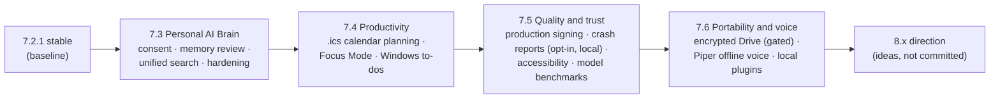

# Abhify.AI roadmap (after 7.2.1)

**Baseline:** 7.2.1 is the stable, owner-validated release (tag `v7.2.1`). Nothing below is implemented yet.

**Rules for every milestone:**
- Each milestone gets its own version, specification, tests and release notes.
- Android, Windows and Web stay independent.
- It stays local-first, with no telemetry and no paid services.
- Nothing private leaves the device without consent.

## 1. Recommended next enhancements (priority order)

| # | Enhancement | Why it matters | Effort |
|---|---|---|---|
| 1 | **Continuous integration** (GitHub Actions, free for public repos): backend pytest, JS harnesses and Android unit tests plus lint on every push | Catches regressions automatically, instead of only during release runs | S |
| 2 | **7.3 M1: unified consent** | One consent model for memory, projects, Study and online providers on all three platforms. Today each feature has its own switch | M |
| 3 | **7.3 M2: memory record and weekly review on Windows and Web** | Android can review memories. Windows has no viewer for what the AI remembers, and Web has none at all | M |
| 4 | **7.3 M3: unified local semantic search** | One search box across chats, Knowledge, projects, Study and memory, with citations | L |
| 5 | **Code health:** split `backend/main.py` (218 routes) into routers, and `AppViewModel.kt` into feature view models | Faster changes and safer reviews. It is a prerequisite for M3 | M |
| 6 | **Compose UI tests and Playwright web tests** | Some UI checks are still static string checks. Real UI tests protect the Study, voice and consent flows | M |
| 7 | **Remove legacy duplicates:** old news paths, the second MCQ generator, old Android Learn screens | Less code, and fewer places for bugs to hide | S |
| 8 | **Production signing** (owner keys): Authenticode for Windows, and an Android release key via APK v3 key rotation | Removes SmartScreen warnings and allows store distribution. Needs owner keys (see `SIGNING_GUIDE.md`) | S, plus owner steps |

**Effort:** S = days, M = 1–2 weeks, L = several weeks.

## 2. Future roadmap

| Version | Theme | Specification |
|---|---|---|
| **7.3** | Personal AI Brain: M1 unified consent → M2 memory record and review → M3 unified local search → M4 hardening and rc. (M0, the privacy fixes, shipped in 7.2.1.) | [ABHIFY_7_3_PERSONAL_AI_BRAIN_SPEC.md](ABHIFY_7_3_PERSONAL_AI_BRAIN_SPEC.md) |
| **7.4** | Productivity: App Control Level 1 (documentation only), calendar-aware Study plans from a local `.ics` file, Focus Mode (Pomodoro linked to Study), Windows to-dos with due dates | [ABHIFY_7_4_PRODUCTIVITY_SPEC.md](ABHIFY_7_4_PRODUCTIVITY_SPEC.md) |
| **7.5** | Quality and trust: production signing, opt-in local crash reports on desktop, accessibility audit on all three platforms, local-model evaluations | [ABHIFY_7_5_QUALITY_AND_TRUST_SPEC.md](ABHIFY_7_5_QUALITY_AND_TRUST_SPEC.md) |
| **7.6** | Portability and voice: encrypted Google Drive backup and portability (only after the `drive.file` permission check), Piper offline text-to-speech on desktop, narrow local plugins and tools | [ABHIFY_7_6_SYNC_SPEECH_PLUGINS_SPEC.md](ABHIFY_7_6_SYNC_SPEECH_PLUGINS_SPEC.md) |

**Supporting design:**
- [Brain implementation roadmap](PERSONAL_AI_BRAIN_IMPLEMENTATION_ROADMAP.md)
- [Platform architecture](PERSONAL_AI_BRAIN_PLATFORM_ARCHITECTURE.md)
- [Data and privacy design](PERSONAL_AI_BRAIN_DATA_AND_PRIVACY_DESIGN.md)
- [Acceptance criteria](PERSONAL_AI_BRAIN_ACCEPTANCE_CRITERIA.md)
- [Threat model](ABHIFY_SECURITY_THREAT_MODEL.md)

## 3. Ideas for 8.x (not committed; each needs its own decision)

- **Web parity:** Knowledge (document search) and Projects in the standalone Web app, using in-browser embeddings and IndexedDB, so they still need no server.
- **On-device model upgrades:** a per-device recommendation that is re-checked when better small models appear, plus a speed and quality benchmark the user can run locally.
- **Study 2.0:** spaced-repetition review of weak topics, and progress charts over weeks.
- **Voice everywhere:** offline speech-to-text on desktop (a local Whisper-class model), so voice works without a browser engine.
- **Accessibility first:** full screen-reader paths, large-text layouts and keyboard-only use, as a release gate.
- **Distribution:** a signed Microsoft Store or winget package, and Google Play internal testing, after production signing.

## 4. Decisions needed from the owner before 7.3 starts

1. Approve the 7.3 M1 scope (unified consent) as the first milestone.
2. Decide whether CI (item 1) goes first, before M1. That is recommended once the GitHub repository exists.
3. Decide when production signing keys will be created (owner-held; never in Git).
