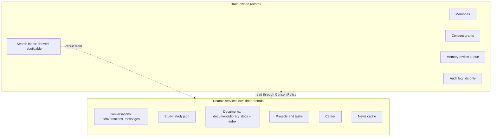
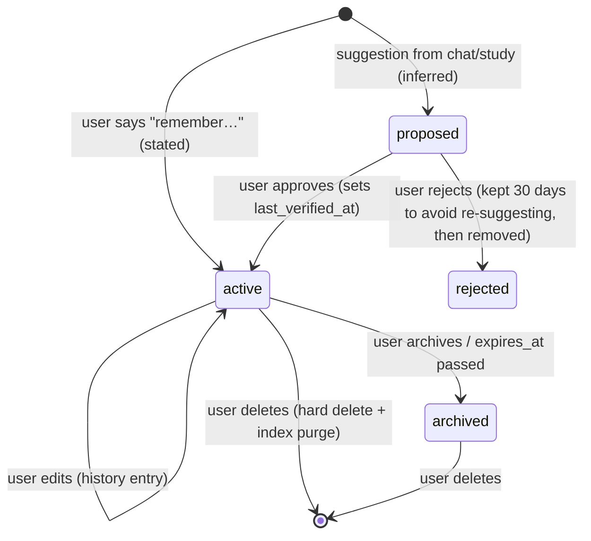

# Personal AI Brain: data and privacy design

**Status:** proposal for owner review. Nothing here is implemented.

**Shared logical contracts:** each platform stores these in its own technology, as SQLite (Windows, Android) or IndexedDB/localStorage (Web). Shared JSON case files test the rules.

## 1. Data ownership



**Rules:**
- The Brain owns only memories, grants, the review queue, the audit log and a **derived** search index.
- The index can always be deleted and rebuilt from owners. Deleting an owner record must delete its index entries (§6).

## 2. Data classes and handling

| Class | Examples | Storage | Online? | Backup |
|---|---|---|---|---|
| Personal memory | Goals, preferences, facts | Brain store | Only with an explicit online grant | Yes |
| Conversation content | Messages | Conversation service | Current chat only, if the user picked a cloud model and online history is allowed | Yes |
| Documents | Uploads, folder files | Document service | Only per-session consent (Android today); never on Windows cloud path | Yes (originals optional) |
| Study records | Courses, answers, stories | `study.json` | Never (Study is local-only) | Windows yes; Android: Study export (backup gap noted) |
| Projects and tasks | Notes, status, to-dos | Project and task services | Never by default | Yes |
| Secrets | API keys, Drive tokens, passphrases | DPAPI / Keystore; none in Web | Never | **Never** |
| Derived index | Chunks, vectors, FTS | Brain index | Never | No (rebuild) |
| Audit log | Ids, labels, decisions | Brain store | Never | Optional |
| Sensitive memory | Health, finance, credentials, identity numbers | Brain store, flagged | Never | Yes (encrypted backups only for Drive) |

## 3. Unified memory record (logical contract `abhify-memory-1`)

| Field | Type | Notes | Windows today | Android today |
|---|---|---|---|---|
| `id` | string/int | Stable id | ✓ | ✓ (`uid`) |
| `content` | text ≤ 500 | User-visible statement | ✓ | ✓ |
| `category` | enum | `goal`, `preference`, `fact`, `learning`, `project`, `decision`, `temporary`, `weak_topic`, `general` | partial | partial |
| `source` | string | `user`, `remember:<conv>`, `suggested:<conv>`, `doc:<id>`, `study:<course>`, `import`, `restore` | `user` / `assistant` | ✓ provenance |
| `status` | enum | `proposed`, `active`, `rejected`, `archived` | — (all active) | `confirmed` (always 1) |
| `confidence` | enum | `stated` (user said it), `inferred` (suggested), `imported`. Inferred is **never** active without approval | — | — |
| `sensitivity` | enum | `normal`, `sensitive` (classifier + user override). Sensitive is never sent online and is excluded from suggestions | — | `MemoryKit.sensitive` check |
| `consent_scopes` | list | Modules allowed to use it (default: `assistant`) | — | — |
| `created_at`, `updated_at` | time | | ✓ | ✓ |
| `last_verified_at` | time | Set when approved or re-confirmed in review | — | `reviewed_at` |
| `expires_at` | time? | Temporary memories, retention | — | ✓ |
| `importance`, `pinned` | int/bool | Kept from both platforms | pinned | importance |
| `use_count`, `last_used_at` | | For review "stale" detection | — | ✓ |
| `history` | list | Corrections: `{at, old, new, by: user}` | — | — |

**Migration** (see `ABHIFY_DATA_MIGRATION_AND_ROLLBACK_PLAN.md`):
- **Windows schema v8:** additive columns with defaults. Every existing memory becomes `status=active`, `confidence=stated`, `sensitivity=normal`, `consent_scopes=[assistant]`.
- **Android V18:** adds `status`, `confidence`, `sensitivity`, `consent_scopes` and `history`, mapping `confirmed=1` to `active`.
- **Web:** adds the fields in IndexedDB on open.

## 4. Consent grants (logical contract `abhify-consent-1`)

```
grant = { module: assistant | study | tasks | focus | plugin:<id>,
          scope:  memory.goals | memory.preferences | memory.facts | study.progress | projects.<id> | tasks.open |
                  documents.<id|collection> | conversations.recent | conversations.history,
          destination: local | online,
          granted_at, granted_by: user, revoked_at? }
```

### Evaluation (`ConsentPolicy.allows(module, scope, destination)`)

1. **Sensitive data never goes online:** if the item is `sensitive` and the destination is `online`, deny.
2. **Global switches win:** if the global memory switch is off and the scope is `memory.*`, deny. This fixes F3.
3. **Project and course switches:** if the request is inside a project with `use_memory=false` and the scope is `memory.*`, deny for retrieval and for creation. This fixes F2.
4. **Look up an active grant** for (module, scope, destination).
   - Online requires a separate online grant; local grants never imply online.
5. **Otherwise deny.**

### Defaults and migration (protecting current behaviour)

Today's behaviour, which defaults must not silently break:
- **Windows:** Chat uses memories when `memory_enabled` (default on).
- **Android:** Chat uses `MemoryKit` when `memories_enabled` (on).
- **Both:** Study uses only ticked items.

| Module | Scope | Default for existing installs | Default for new installs |
|---|---|---|---|
| assistant | `memory.*` (local) | **granted**, mirroring `memory_enabled` (no behaviour change) | granted (same as today) — *decision D4: owner may prefer off* |
| assistant | `conversations.recent` (local) | granted | granted |
| assistant | anything (online) | denied, except `conversations.recent` mirroring Android `online_history` (decision D5) | denied |
| study | per-course ticked items | migrated as grants scoped to that course | off |
| tasks | all | off | off |
| any | `documents.*` | only inside project or explicit document chats (fixes F4) | same |

**Revocation:** the grant gets `revoked_at`. All later requests deny immediately, because grants are read per request and the index filter is applied at query time.

**Audit:** every grant change writes an audit event `{at, module, scope, destination, action: grant|revoke}`.

## 5. Memory lifecycle and weekly review



### Review queue items (shared rules, ported from Android `MemoryReview`)

- `new_proposal`: proposed since the last review.
- `conflict`: two active memories that contradict each other.
- `duplicate` / `combine`.
- `expiring` / `expired`.
- `stale`: unused for 90 days and not pinned.
- `sensitive_check`: active, classified sensitive, never confirmed as such.

### The weekly review screen ("What Abhify learned about me")

- **When it appears:** a quiet card shows the count. It opens only when the user taps it; there are no notifications by default.
- **Each item shows:** the content, why it was suggested, and its source link. If the source was deleted, it says "source deleted".
- **Actions on each item:** approve, edit, reject, delete, mark temporary (with an expiry), change category, resolve conflict.
- **Deletion copy:** "Deleting this memory removes it from Abhify's memory and search. The chat or document it came from is not deleted; delete that separately if you want."

**Never:** silently activate an inferred memory, fabricate details, or store a sensitive item without the user confirming it.

## 6. Deletion propagation

| User deletes | Must also delete | Must not delete |
|---|---|---|
| A memory | Its index entries, its review items, its audit labels (ids kept, labels removed) | The source conversation or document |
| A conversation | Its index entries; proposals sourced from it (proposed only) | Active memories (they show "source deleted") |
| A document | Its chunks, vectors and FTS rows; project references to it | Memories derived from it (they show "source deleted") |
| A course or story | Its index entries | Memories |
| "Delete everything" | All of the above, plus grants and the audit log | Models, backups the user exported |

Each row gets a regression test: delete → search → no hit (test strategy §3).

## 7. Audit log (`abhify-audit-1`)

- **Records:**
  - `{at, kind: context_used | grant | revoke | memory_change | proposal | model_route, module, ids[], labels[], model}`
  - For example, `context_used` lists memory ids and document ids.
- **Never recorded:** message text, document text, audio.
- **Limits:** local only; capped at 5,000 events or 180 days.
- **User controls:** viewable in Privacy Center; exportable and deletable by the user.

## 8. Sensitive-information handling

- **Classifier (deterministic):** patterns for health, finance and account numbers, government IDs, passwords and keys, exact addresses, and phone numbers. These extend Android `MemoryKit.sensitive` and Windows `document_indexer` secret patterns, with shared cases.
- **Effect:** a sensitive memory needs explicit confirmation, is never sent online, is excluded from suggestions and Study context, and is shown with a badge.
- **Secrets** (API keys, tokens, passphrases) are never memories. Attempts are refused with a message.

## 9. External transmission rules (all platforms)

1. Local models are the default. Cloud is off until the user enables a provider (current behaviour).
2. Online prompts may contain only the current message, the recent chat if allowed, and items with an online grant. Never: sensitive memories, documents without per-session consent, local evidence (projects, tasks, system), Study data, or the user name unless granted (fixes F1).
3. Live lookups send only the query, the city or the currency pair, as today.
4. No telemetry. Crash reports are local and opt-in (7.5).
5. Drive (7.6) uploads only locally encrypted bundles.
