# Personal AI Brain: implementation roadmap

**Status:** proposal. **Nothing starts until you approve the architecture, the specifications, the migration plan and the milestone scope.**

## 1. Sequence

```mermaid
gantt
  title Proposed sequence (effort in working days, not calendar dates)
  dateFormat X
  axisFormat %s
  section 7.3 Personal AI Brain
  M0 privacy fixes           :m0, 0, 2
  M1 consent core            :m1, after m0, 6
  M2 memory record + review  :m2, after m1, 8
  M3 unified search          :m3, after m2, 12
  M4 hardening + rc          :m4, after m3, 3
  section 7.4 Productivity
  App Control L1 docs        :a1, after m4, 2
  ICS import + slots         :a2, after a1, 8
  Focus Mode                 :a3, after a2, 4
  section 7.5 Quality & Trust
  Signing prep (both)        :q1, after a3, 2
  Crash reports (desktop)    :q2, after q1, 3
  Accessibility audit + fixes:q3, after q2, 6
  Model benchmarks           :q4, after q3, 5
  section 7.6 (Drive gated)
  Piper TTS                  :s1, after q4, 5
  Local plugins (narrow)     :s2, after s1, 8
  Drive portability          :crit, s3, after s2, 10
```

The estimates assume the current way of working: I build, an agent ports to Android, and the suites, E2E and Sandbox run before each build. Your physical testing time is not included.

**Rules from your spec:**
- Releases are not combined.
- A milestone doesn't start while a critical dependency of an earlier one is open.
- App Control L1 stays docs-only.
- Drive stays blocked until the drive.file check passes.
- Production signing waits for your keys.

## 2. Recommended first implementation milestone: 7.3 M0 + M1

**Why first:**
- M0 fixes verified privacy gaps (F1–F5) that exist **today** in shipped builds. F1 is the most important: local project and task evidence can reach an online provider's prompt.
- M1 builds the one piece every later feature depends on (consent enforced in services). It changes no visible behaviour for current users, because the migration mirrors today's switches.

**What it protects:**
- the "no personal data to cloud" promise;
- project isolation;
- the existing Assistant and Study behaviour, because defaults are mirrored and there is an Assistant fallback path.

**Size:** about 8 working days, plus your review and test.

## 3. Reuse versus new code

| Reused (verified) | New |
|---|---|
| Memory services (W, A), Android MemoryReview, FTS5/FTS4, Chroma, Android hybrid RRF, Study opt-in, provider consent, agent tool typing, CrashNote, vault/sync engines, Whisper | ConsentPolicy + grants, unified memory fields, review UI on W and Web, unified search index, ICS parser, slot finder, Focus state machine, crash module (desktop), benchmark harness, Piper adapter, plugin host |

## 4. Consolidation along the way (low risk, opportunistic)

| Item | When | How |
|---|---|---|
| Legacy `brain.search`, `/news` (generators), Android `vm.news` | 7.3 | Remove only after the frontend stops calling them; tests updated |
| Old Learn stores (Android) → Study | 7.3–7.4 | Read-only import into Study; old screens kept until you approve their removal |
| Legacy Question Bank/MCQ tabs (web) | 7.4 | Entry points redirect to Study practice; data kept |
| DPAPI helper duplication | 7.3 M1 | One helper (tests cover both callers) |
| `PREF_KEYS` divergence | 7.6 | Fixed with protocol v2 |
| Split `main.py` (212 routes) into routers | not planned | High churn, low user value; revisit after 7.6 |
| Split Android `AppViewModel` (1,746 lines) | gradual | `BrainService` takes context assembly out first |

## 5. Decisions requiring owner approval

| ID | Decision | My recommendation | Why |
|---|---|---|---|
| D1 | Renumber App Control levels (L1 = proposal only) and annotate the 2026-11-23 proposal | Yes | Matches your spec; avoids two meanings of "Level 1" |
| D2 | Memory schema migration (Windows v8, Android V18, Web store v2) | Approve, with the plan's backups | Needed for status, confidence and sensitivity; additive |
| D3 | Embeddings: Windows reuse Ollama `nomic-embed-text` (already the Knowledge model); Android bge-small (already offered); Web keyword-only in 7.3 | Yes | No new downloads; Web embeddings would need a new vendored model (≈30–100 MB) |
| D4 | Default for Assistant use of memories (today ON when memory is on) | Keep ON for existing installs; ask during setup for new installs | Avoids surprising existing users; privacy-preserving for new ones |
| D5 | Android `online_history` default (today ON) | OFF for new installs; existing unchanged but shown in Privacy Center | Aligns with "external disabled by default" |
| D6 | Fix F9 (remote delete-all from paired owner devices) | Keep for owner devices but require a fresh confirm on the computer | Paired phones are the owner's; deletion should still be confirmable locally |
| D7 | Android server sync (`sync/`, off by default) vs the manual vault design | Retire the server sync in 7.6 (keep code until then, hidden) | Conflicts with "no shared backend"; vault is the approved direction |
| D8 | Android `REQUEST_INSTALL_PACKAGES` with no updater UI | Remove the permission until an updater UI is approved | Unused sensitive permission |
| D9 | Ship M0 privacy fixes as a 7.2.x patch before 7.3 | Yes (7.2.1-dev) | They affect current builds |
| D10 | Standalone Web: add Knowledge/Projects in the browser, or keep them desktop-only | Keep desktop-only for 7.3; revisit after 7.4 | Large effort; IndexedDB document storage and quota limits |
| D11 | Piper packaging and default voice | Download on confirm (no bundle); one English voice offered first | Keeps the installer size; explicit consent |
| D12 | Desktop to-do list with due dates (Android has one); plugins on Android | Add desktop to-dos in 7.4 (needed by Focus and calendar); no Android process plugins in 7.6 | Parity where it matters; Android sandboxing is limited |
| D13 | Sync protocol v2 (new kinds) | Approve in principle; implement only after the Drive gate | Your rule: no protocol change without approval |

## 6. Risks

| Risk | Impact | Mitigation |
|---|---|---|
| Consent mirroring misses a path, and context silently drops after the upgrade | Assistant answers worse | Upgrade tests compare context before and after (BR-013) |
| Android V18 migration on large databases | Upgrade failure | Backup copy, transaction, fixtures from V14–V17 |
| Unified index too large or slow on 6 GB phones | Battery and storage | Keyword-first; embeddings only when the gate allows; size shown (BR-037) |
| ICS complexity (RRULE, DST) | Wrong availability | Large shared fixture set; 60-day window cap |
| Accessibility claims without manual tests | Misleading | The register states the method per item |
| drive.file cross-client limits | 7.6 blocked | Gate check first; alternatives documented |
| Scope creep from the size of the spec | Delays and regressions | Milestone gates, and a full regression run each time |
