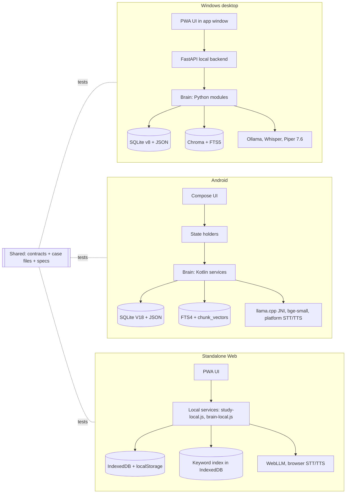

# Personal AI Brain: platform architecture

**Status:** proposal.

**Principle:** each platform runs its own Brain, using native technology. What platforms share is the logical contracts (`abhify-memory-1`, `abhify-consent-1`, `abhify-audit-1`, `abhify-search-1`) and the case files under `backend/tests/data/`.

## 1. Independence model

There is no arrow between platforms. Drive portability (7.6) is a manual, encrypted file exchange, not a connection.

## 2. Windows desktop

| Concern | Design | Reuses |
|---|---|---|
| Brain modules | New `backend/brain_core.py` (pure rules: consent evaluation, memory review, ranking fusion) + `brain_service.py` (I/O). Wired into `agent._prepare` and `stream_cloud` behind one function `context_for(request)` | `memory_service`, `knowledge`, `projects`, `study`, `realtime`, `intelligence` |
| Consent | Table `consent_grants` (schema v8) + `audit_events` | prefs `memory_enabled`, project `use_memory`, Study brain |
| Memory | `memories` + v8 columns; `memory_history` table | FTS5 `memories_fts` |
| Search | Unified index: FTS5 table `search_fts(source, ref, title, body)` + Chroma collection `brain_index` (same embed model as Knowledge: `nomic-embed-text`) | Chroma, Ollama embeddings |
| Routes | `/brain/consent`, `/brain/memory/review`, `/brain/search`, `/brain/audit`, all `local_only` and not on remote allow-lists | `companion.check` |
| Models | Existing `_chat_model`; router reads benchmark results (7.5), never auto-switches | `system_service`, `hardware_advisor` |
| Speech | Whisper (unchanged); Piper adapter (7.6) | `transcribe.py` |
| Constraints | One `main.py` (212 routes) is large: new routes go in a dedicated section; no APIRouter refactor in 7.3 (risk) | |

## 3. Android

| Concern | Design | Reuses |
|---|---|---|
| Brain | `brain/BrainCore.kt` (pure, shares cases) + `brain/BrainService.kt`; `AppViewModel.answer` calls `BrainService.contextFor` instead of assembling sources inline (shrinks the 1,746-line ViewModel gradually) | MemoryKit, MemoryReview, RagIndex, ContextResolver, ContextOrchestrator |
| Consent | ChatDb V18 tables `consent_grants`, `audit_events` | `online_*` prefs, `Consent` dialog, Study brain |
| Memory | V18 columns (status, confidence, sensitivity, consent_scopes) + `memory_history` | V9/V13 columns, `memory_dismissed` |
| Search | Extend `doc_chunks`/`chunk_vectors` pattern to a `search_items` table for chats, lessons, stories, notes; FTS4 + vectors (bge-small, only if downloaded) + RRF | `Retrieval.kt`, `SchemaV9` FTS |
| Constraints | Embeddings refuse under low memory, battery saver or thermal limits (existing gate): keyword-only fallback must always work | `HeavyGate`, `MemoryPolicy` |
| Background | No new background work for the Brain in 7.3 (incremental indexing on save) | |

## 4. Standalone Web

| Concern | Design | Reuses |
|---|---|---|
| Brain | `frontend/brain-core.js` (port, shared cases) + `brain-local.js` (IndexedDB) | `study-local.js` pattern (same route shapes as desktop, answered in-browser) |
| Memory | IndexedDB `memories` gains contract fields; a **viewer and review UI** (currently missing) | `ondevice.js` `local` store |
| Search | Keyword index (IndexedDB inverted index) over chats, memories, Study. **No embeddings in 7.3** (WebLLM has no embedding model vendored; decision D3) | — |
| Consent | IndexedDB `grants`; same evaluation code (`brain-core.js`) | — |
| Constraints | Storage quota: handled the same way as Study (clear "storage full" message); clearing site data removes everything (said in the UI) | Study quota handling |
| Scope limits | Documents, projects and news stay desktop-only unless D10 approves Web versions | — |

## 5. Capability matrix (target after 7.3)

| Capability | Windows | Android | Web |
|---|---|---|---|
| Unified consent | ✓ | ✓ | ✓ |
| Memory record v1 + review | ✓ | ✓ (existing review extended) | ✓ (new viewer) |
| Search: chats | FTS5 + semantic | FTS4 + semantic (if model) | keyword |
| Search: documents | Chroma + FTS5 | hybrid | — (no documents) |
| Search: lessons, stories, notes | ✓ | ✓ | lessons and stories (keyword) |
| Online destinations | provider chat | provider chat | none (on-device only) |

## 6. Model routing inputs per platform

| Input | Windows | Android | Web |
|---|---|---|---|
| RAM / VRAM / GPU | `system_service.diagnostics`, nvidia-smi | `DeviceProbe`, `MemoryPolicy` | `navigator.deviceMemory`, WebGPU adapter |
| Acceleration | CUDA/Vulkan via Ollama | Vulkan per-model validated (`GpuPolicy`) | WebGPU required |
| Battery / thermal | n/a | `HeavyGate` | not available |
| User preference | default and per-chat model | `pickModel`, `ai_mode` | device model |
| Benchmarks (7.5) | `docs/benchmarks/*` results | same | same (WebLLM models) |

**Rule:** the router may recommend; it never changes the user's chosen model without an explicit action.
