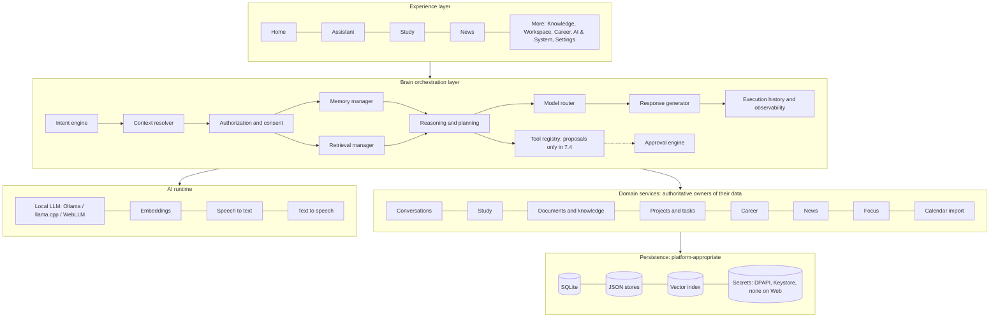
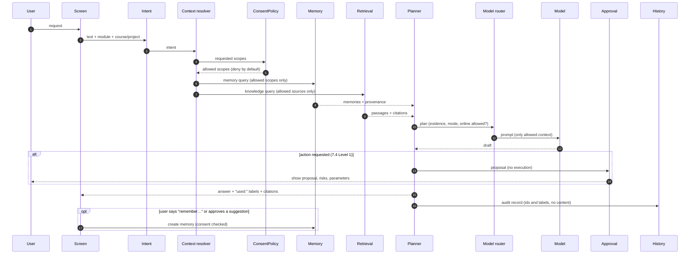
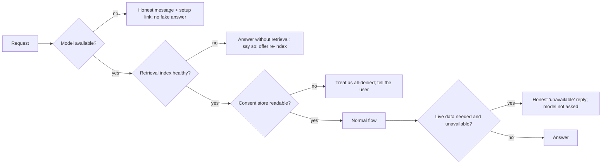

# Personal AI Brain: strategic architecture

**Status:** proposal for owner review. Nothing here is implemented.

**Related documents:**
- Facts come from `PERSONAL_AI_BRAIN_CURRENT_STATE_AUDIT.md`.
- Data rules are in `PERSONAL_AI_BRAIN_DATA_AND_PRIVACY_DESIGN.md`.
- Per-platform detail is in `PERSONAL_AI_BRAIN_PLATFORM_ARCHITECTURE.md`.

## 1. What the Brain is (and is not)

The Personal AI Brain is an **orchestration layer inside each installation**. It sits between the screens (Home, Assistant, Study, News, More) and the existing domain services: conversations, Study, documents and knowledge, projects and tasks, career, news, focus, calendar import.

**It does:**
- recognise intent;
- resolve which context is relevant and allowed;
- fetch memory and knowledge through permission filters;
- plan the response;
- route to a model;
- prepare (never auto-run) actions;
- record what it did.

**It is not:**
- another chatbot;
- a new database that copies module data;
- a shared cloud service;
- a security authority. Permissions are enforced in code, never by the model.

**Guiding rule:** one Brain per installation and three independent platforms. Contracts, rules and test cases are shared; there is no shared runtime and no automatic sync.

## 2. Layers

## 3. Components

| # | Component | Responsibility | Built from (existing) | New work |
|---|---|---|---|---|
| 1 | Intent engine | Classify the request: chat, study, task, search, action, memory command, identity | `intelligence.detect` (W), `intel/Brain.kt` + `Intelligence.kt` (A), `realtime.resolve`, `model_switch`, AppActions | Shared intent fixture (extends `realtime_intents.json`) |
| 2 | Context resolver | Decide which **context scopes** a request may use: module, sources, time | `ContextResolver.kt`, `ContextOrchestrator.kt` (A); `agent._prepare` (W) | Scope objects; same rules on 3 platforms |
| 3 | Authorization and consent | Enforce consent grants, project and course scopes, online/offline rules **before** retrieval | `memory_enabled`, `use_memory`, provider consent, `online_*` flags, Study opt-in | **ConsentPolicy** service plus shared cases (core of 7.3) |
| 4 | Memory manager | Propose, confirm, edit, expire and retrieve memories; weekly review | `memory_service` (W), `MemoryKit` + `MemoryReview` (A) | Unified memory record (data design §3); review on W and Web |
| 5 | Retrieval manager | Hybrid keyword + semantic search across allowed sources, with citations | Chroma + FTS5 (W); FTS4 + vectors + RRF (A) | Unified index of allowed sources per platform (7.3 search) |
| 6 | Reasoning and planning | Build the turn plan: which evidence, which mode, whether to propose an action | `agent.py` modes; `Brain.kt` planner | Planner returns a structured plan (testable) |
| 7 | Model router | Pick a model by task and device; never silently swap | `_chat_model` (W), HybridAi `RoutePolicy` (A), hardware advisor, ModelSelector | Task requirements table; reads 7.5 benchmarks (never auto-replaces the user's choice) |
| 8 | Tool registry | Catalogue of capabilities and their risk; produces **proposals** | `agent` tool typing (READ / REVERSIBLE / SENSITIVE), AppActions | 7.4 docs only. No execution path in Level 1 |
| 9 | Approval engine | Show proposal, risks and parameters; collect a yes/no | `confirm` flags, Android Consent dialog | Docs (7.4); used later by plugins (7.6) |
| 10 | Execution history | Record decisions: what context was used, which model, what was proposed or approved. No message content | `agent_runs.json` (W, A), `VoiceLog`, Study history | One local audit log per platform (data design §7) |

## 4. Request lifecycle

**Rules enforced in code:**
1. **Deny by default.** A source reaches the model only if `ConsentPolicy.allows(module, scope, destination)` returns true. This is checked in the service layer on every platform, not only in the UI.
2. **Destination matters.** Online destinations get a stricter subset: no memories, documents or local evidence unless granted for online use (fixes F1).
3. **Revocation is immediate.** Grants are read on every request, never cached across requests.
4. **The model never decides permissions.** Model output can propose, never authorize.
5. **Untrusted content is fenced.** Document, news, web and plugin text is marked as data, not instructions (already done in task runner and news).
6. **Every answer that used personal context says so.** "Used: …" labels, as Study lessons already do.

## 5. Unified context scopes

| Scope | Examples | Default |
|---|---|---|
| `memory.goals` | Goal memories | Off for new modules; existing Chat behaviour preserved (see decision D4) |
| `memory.preferences` | Answer style, likes | Same as above |
| `memory.facts` | Approved facts about the user | Off |
| `study.progress` | Courses, weak topics, readiness | Off outside Study |
| `projects.<id>` | One project's notes, status, documents | Off; per project |
| `tasks.open` | To-do titles and due dates | Off |
| `documents.<collection or id>` | Knowledge documents | Off outside explicitly scoped chats |
| `conversations.recent` | Last N turns of the current chat | On, current chat only (existing behaviour) |
| `conversations.history` | Older chats | Off |

The **modules** that can hold grants are `assistant`, `study`, `tasks` (and later `focus`, `plugins`). A grant is (module, scope, destination: local | online). Defaults and migration are in the data design §4.

## 6. Error and recovery flows

The F branch already exists today. B is partial. C and D are new.

## 7. Why this shape protects existing work

| Decision | Protects |
|---|---|
| The Brain wraps domain services instead of copying their data | Study, Projects, Knowledge and News stay the owners of their data; no double-writes, no new migration risk |
| Consent policy as a separate service with shared test cases | The same privacy rules on all platforms; regressions caught by shared fixtures, as Study rules are today |
| Assistant works when Brain services fail (fallback to today's `_prepare` / `answer` path) | Chat never breaks because an index or consent store fails |
| Incremental: 7.3 adds consent, memory review and search; 7.4 adds planning inputs; App Control stays docs-only | Each step can be released and rolled back alone |
| No shared runtime | Platform independence (owner's core rule) |
